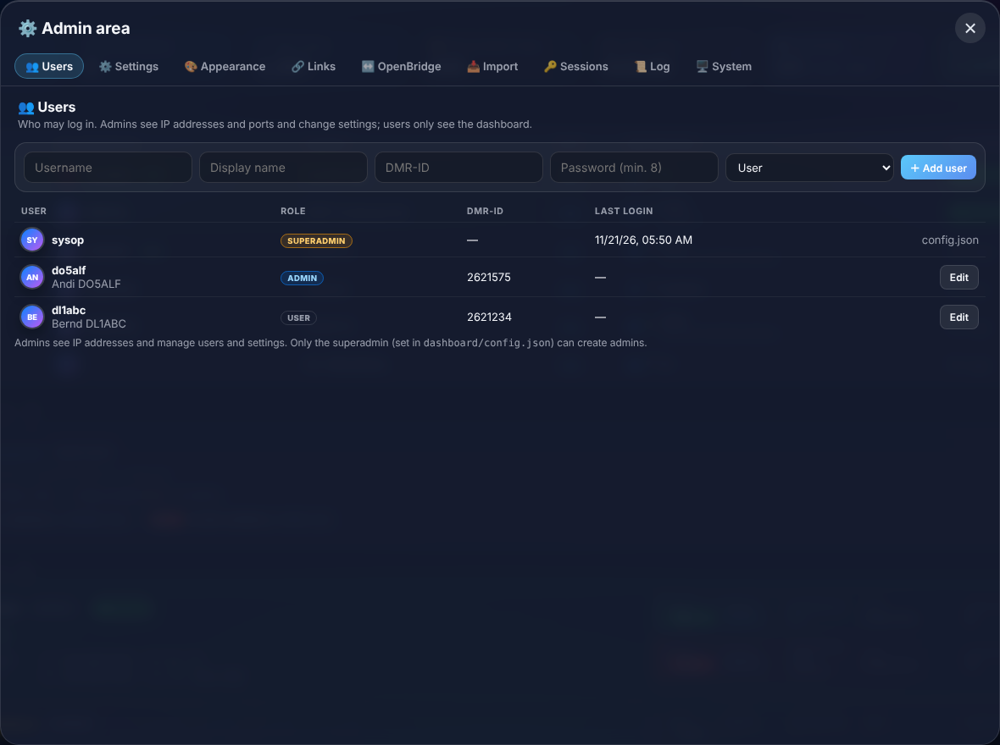
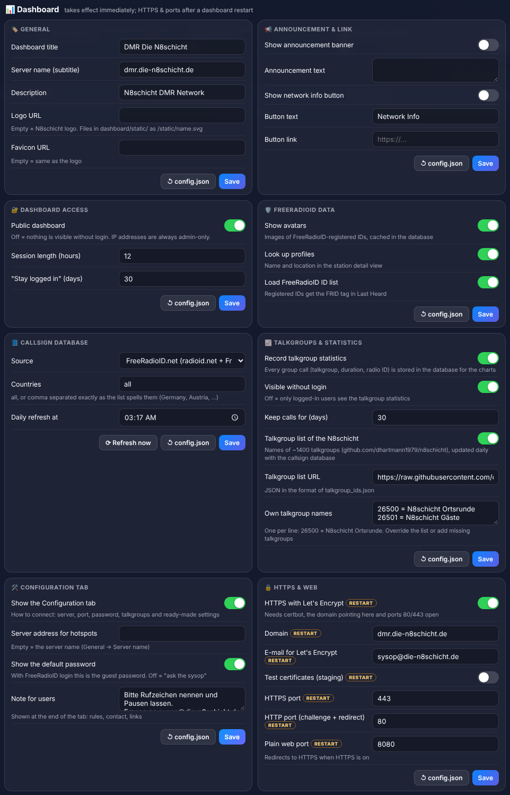
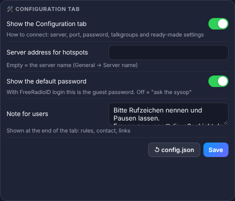
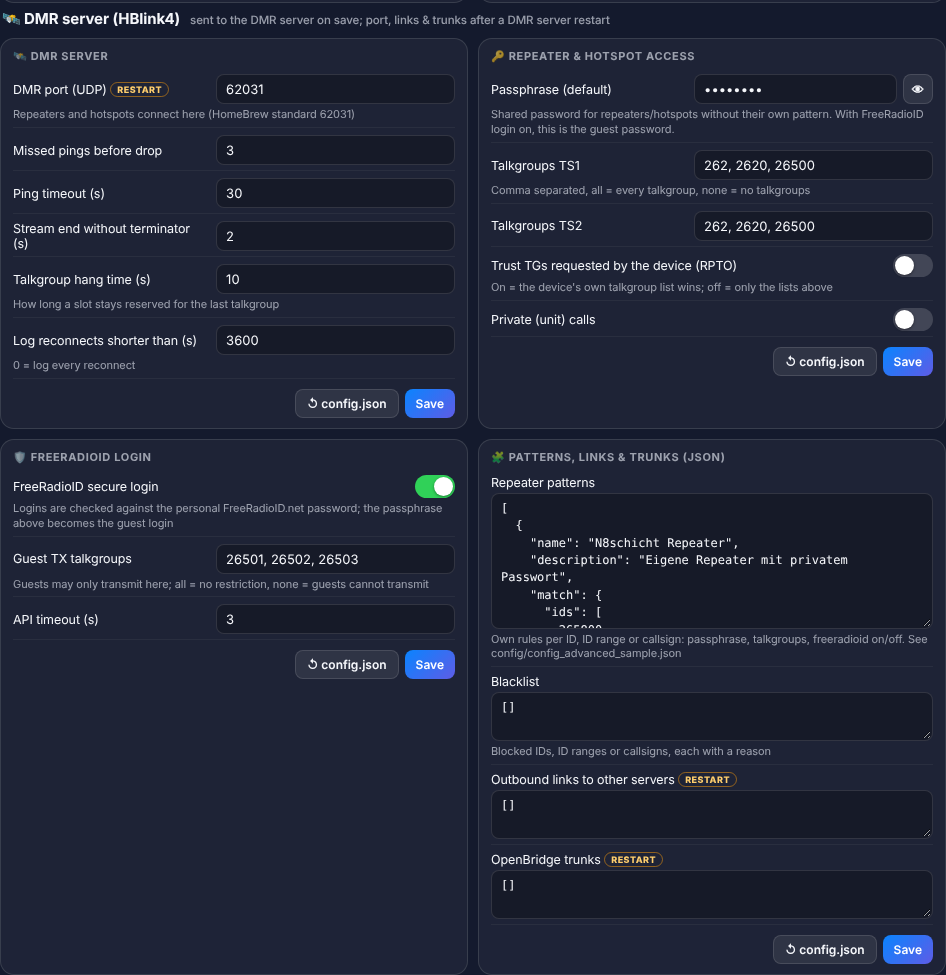
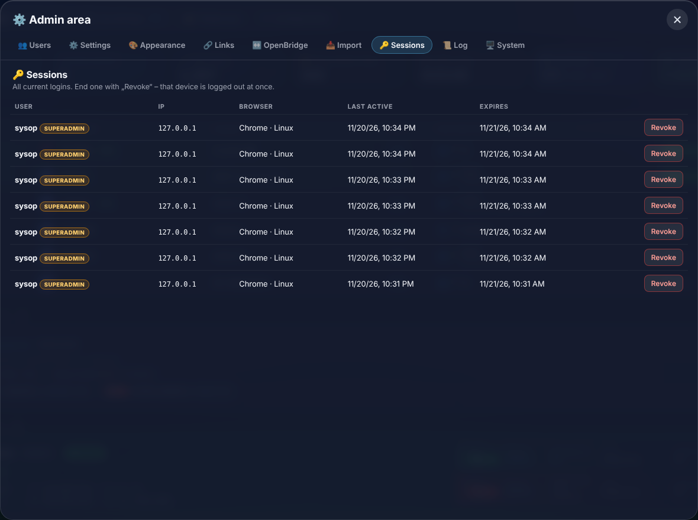

# ⚙️ Adminbereich

[← Übersicht](../../readme.md) · [Installation](installation.md) · [Dashboard](dashboard.md) · **Adminbereich** · [Konfiguration](konfiguration.md) · [FreeRadioID](freeradioid.md) · [Betrieb & Fehlersuche](betrieb.md)

---

Im Adminbereich stellst du **Dashboard und DMR-Server** ein, ohne SSH und ohne Config-Dateien. Alles wird in SQLite gespeichert (`dashboard/data/dashboard.db`).

## Anmelden

  
  &nbsp;
  

**🔐 Login** oben rechts. Mit *Angemeldet bleiben* gilt die Anmeldung 30 Tage, sonst 12 Stunden; beides ist einstellbar. Nach 5 Fehlversuchen ist der Login für 15 Minuten gesperrt.

## Rollen

| Rolle | Darf |
|---|---|
| **Superadmin** | alles, auch Admins anlegen. Er steht **nur** in `dashboard/config.json` und kann im Browser weder gelöscht noch herabgestuft werden. So kannst du dich nie aussperren. |
| **Admin** | sieht **IP-Adressen**, verwaltet Benutzer, alle Einstellungen, Sitzungen, Protokoll, Neustarts |
| **User** | sieht das Dashboard, auch wenn es nicht öffentlich ist; keine IP-Adressen |
| nicht angemeldet | sieht das öffentliche Dashboard ohne IP-Adressen |

IP-Adressen werden **auf dem Server** entfernt, bevor Daten an Nicht-Admins gehen, also nicht nur im Browser ausgeblendet.

## 👥 Users

- **Anlegen**: Benutzername, Anzeigename, DMR-ID (für den Avatar), Passwort (mindestens 8 Zeichen) und Rolle. Admins kann nur der Superadmin anlegen.
- **Bearbeiten**: Name, DMR-ID, Rolle, neues Passwort, sperren. Wer gesperrt wird oder ein neues Passwort bekommt, wird sofort abgemeldet.
- **Löschen**: Zur Sicherheit braucht es zwei Klicks.

## ⚙️ Settings

Hier stehen **alle** Einstellungen, oben das Dashboard, darunter der DMR-Server. Jeder Abschnitt hat einen eigenen **Save**-Knopf. Mit **↺ config.json** holst du einen Abschnitt wieder aus der Config-Datei.

### 📊 Dashboard

&nbsp;

| Abschnitt | Einstellungen | Wirkt |
|---|---|---|
| 🏷️ General | Titel, Untertitel, Beschreibung, Logo, Favicon | sofort auf allen offenen Seiten |
| 📢 Announcement & link | Hinweis-Banner, Info-Knopf mit Link | sofort |
| 🔐 Dashboard access | öffentlich ja/nein, Sitzungsdauer, „angemeldet bleiben“ | sofort |
| 🛡️ FreeRadioID data | Avatare, Profilabfrage, FreeRadioID-ID-Liste | sofort |
| 📘 Callsign database | Quelle (**FreeRadioID.net**, Vorgabe, oder nur radioid.net), Länder, Uhrzeit des Updates, **⟳ Refresh now** | sofort; bei neuer Quelle oder neuen Ländern wird die Liste gleich neu geladen |
| 📈 Talkgroups & statistics | **Talkgroup-Liste der N8schicht** an/aus und ihre URL (Vorgabe: `talkgroup_ids.json` aus [dhartmann1979/n8schicht](https://github.com/dhartmann1979/n8schicht)), Statistik an/aus, ohne Login sichtbar, Speicherdauer (Vorgabe 30 Tage), **eigene Namen** (`26500 = N8schicht Ortsrunde`, eine pro Zeile; sie überschreiben die Liste) | sofort; eine neue URL wird gleich geladen |
| 🛠️ Configuration tab | Tab an/aus, Server-Adresse für Hotspots (leer = Servername), Standard-Passwort zeigen ja/nein, **Hinweis für Nutzer** | sofort |
| 🔒 HTTPS & web | HTTPS, Domain, E-Mail, Test-Zertifikate, Ports | nach **Neustart** des Dashboards |

  
  &nbsp;
  

Die **Talkgroup-Namen** gelten für die Statistik und für den Tab *Configuration*.

Ältere Gespräche als die eingestellte Speicherdauer löscht das Dashboard jede Nacht. Ist die Statistik aus, wird nichts mehr gespeichert und der Tab **📈 Statistics** verschwindet aus dem Dashboard.

### 🛰️ DMR-Server (HBlink4)

| Abschnitt | Einstellungen | Wirkt |
|---|---|---|
| 🛰️ DMR server | DMR-Port, verpasste Pings, Timeouts, Hang-Time, Reconnect-Logging | sofort; der **Port** erst nach Neustart des DMR-Servers |
| 🔑 Repeater & hotspot access | Standard-Passwort, Talkgroups TS1/TS2 (`all` = alle, `none` = keine), ob die Talkgroup-Liste des Geräts (RPTO) gilt, Einzelrufe | sofort für neue Anmeldungen; Talkgroups auch für verbundene Stationen ohne eigene Liste |
| 🛡️ FreeRadioID login | Secure Login an/aus, Gast-Talkgroups, API-Timeout | sofort |
| 🧩 Patterns, links & trunks | eigene Regeln pro ID/Rufzeichen, Blacklist, Verbindungen zu anderen Servern, OpenBridge, jeweils als JSON | Patterns und Blacklist sofort, Verbindungen nach Neustart |

**So kommen die Änderungen beim DMR-Server an:** Beim Speichern schickt das Dashboard dem DMR-Server über ihre gemeinsame Verbindung den Befehl *Einstellungen übernehmen*. HBlink4 liest die Datenbank neu und meldet im Log `⚙️ Settings from the admin area applied`.
- **Neustart nötig:** Bei Port, Links oder Trunks erscheint ein Hinweis mit dem Knopf **Restart DMR server**.
- **DMR-Server nicht verbunden:** Läuft er gerade nicht, übernimmt er die Werte beim nächsten Start.

**Patterns werden vor dem Speichern geprüft:** HBlink4 muss ein Pattern verstehen, sonst wird es abgelehnt und die alten Regeln bleiben. Beispiele stehen in [Konfiguration → Patterns](konfiguration.md#patterns-eigene-regeln-pro-repeater).

## 🔑 Sessions, 📜 Log, 🖥️ System

  
  

- **Sessions**: alle Anmeldungen mit IP, Browser und Ablauf; jede lässt sich beenden.
- **Log**: Anmeldungen, Fehlversuche, Benutzer- und Einstellungsänderungen, Neustarts, jeweils mit Zeit, Person und IP.
- **System**: HTTPS mit Ablaufdatum des Zertifikats, Zugriff, Verbindung zum DMR-Server, FreeRadioID-IDs und gespeicherte Avatare. Dazu die Knöpfe **Restart dashboard** und **Restart DMR server**; sie erscheinen nur, wenn beides als systemd-Dienst läuft.

---

Weiter: [🧾 Konfiguration](konfiguration.md)
