# ⚙️ Adminbereich

[← Übersicht](../../readme.md) · [Installation](installation.md) · [Dashboard](dashboard.md) · **Adminbereich** · [Anleitungen](anleitungen.md) · [Konfiguration](konfiguration.md) · [FreeRadioID](freeradioid.md) · [Betrieb & Fehlersuche](betrieb.md)

---

Im Adminbereich stellst du **Dashboard und DMR-Server** ein, ohne SSH und ohne Config-Dateien. Alles wird in SQLite gespeichert (`dashboard/data/dashboard.db`).

## Anmelden

  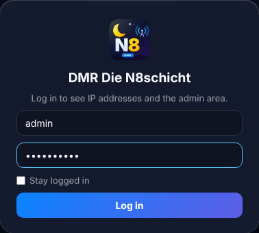
  &nbsp;
  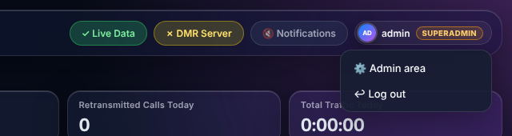

**🔐 Login** oben rechts. Mit *Angemeldet bleiben* gilt die Anmeldung 30 Tage, sonst 12 Stunden; beides ist einstellbar. Nach 5 Fehlversuchen ist der Login für 15 Minuten gesperrt.

## Rollen

| Rolle | Darf |
|---|---|
| **Superadmin** | alles, auch Admins anlegen. Er steht **nur** in `dashboard/config.json` und kann im Browser weder gelöscht noch herabgestuft werden. So kannst du dich nie aussperren. |
| **Admin** | sieht **IP-Adressen und Ports**, verwaltet Benutzer, alle Einstellungen, Sitzungen, Protokoll, Neustarts |
| **User** | sieht das Dashboard, auch wenn es nicht öffentlich ist; keine IP-Adressen und Ports |
| nicht angemeldet | sieht das öffentliche Dashboard ohne IP-Adressen und Ports |

**Nur für Admins:** IP-Adressen und Ports von Repeatern, Hotspots, Outbound-Links und OpenBridge-Trunks, also Gegenstelle, Port der Gegenstelle und unser lokaler Port. Der Server entfernt sie, bevor Daten an Nicht-Admins gehen; sie werden also nicht nur im Browser ausgeblendet. Nicht-Admins sehen an diesen Stellen **🔒 hidden**.

## 👥 Users

- **Anlegen**: Benutzername, Anzeigename, DMR-ID (für den Avatar), Passwort (mindestens 8 Zeichen) und Rolle. Admins kann nur der Superadmin anlegen.
- **Bearbeiten**: Name, DMR-ID, Rolle, neues Passwort, sperren. Wer gesperrt wird oder ein neues Passwort bekommt, wird sofort abgemeldet.
- **Löschen**: Zur Sicherheit braucht es zwei Klicks.

## Aufbau

Oben wählst du den Bereich: **👥 Users · ⚙️ Settings · 🎨 Appearance · 🔗 Links · ↔️ OpenBridge · 📥 Import · 🔑 Sessions · 📜 Log · 🖥️ System**. Am Smartphone ist das eine Auswahlliste. Das Fenster ist immer gleich groß, egal welcher Bereich offen ist; nur der Inhalt rollt. Jeder Bereich beginnt mit einem Satz, worum es geht.

Schritt-für-Schritt-Anleitungen für die häufigsten Aufgaben stehen in [🧭 Anleitungen](anleitungen.md).

Für alle Bereiche gilt:
- **Schalter** für Ja/Nein, **Auswahllisten** statt Texteingaben, wo es feste Möglichkeiten gibt.
- **Nur was gerade zählt, ist sichtbar:** Ist ein Schalter aus, verschwinden die Felder, die davon abhängen. Ohne Ankündigung kein Textfeld für die Ankündigung, ohne HTTPS keine Domain.
- **Seltene Einstellungen** stehen unter **▸ Advanced options**.
- **unsaved** zeigt ungespeicherte Änderungen an; gespeichert wird mit **💾 Save**.

## ⚙️ Settings

&nbsp;
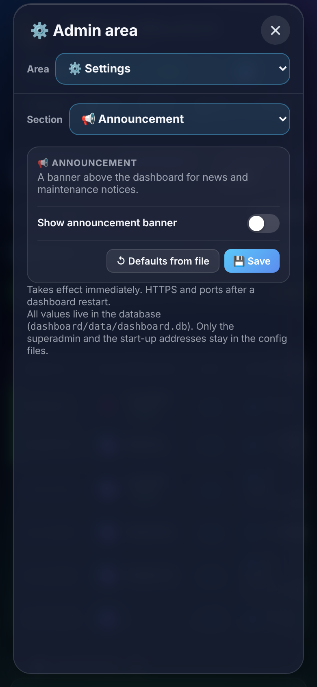

Links steht die Liste der Abschnitte, rechts der gewählte Abschnitt mit einem Satz, worum es geht. Am Smartphone wählst du den Abschnitt aus einer Liste. **↺ Defaults from file** holt einen Abschnitt wieder aus der Config-Datei.

### 📊 Dashboard

| Abschnitt | Einstellungen | Wirkt |
|---|---|---|
| 📢 Announcement | Hinweis-Banner an/aus und Text | sofort |
| 🔐 Dashboard access | öffentlich ja/nein, Sitzungsdauer, „angemeldet bleiben“ | sofort |
| 🛡️ FreeRadioID data | Avatare, Profilabfrage, FreeRadioID-ID-Liste | sofort |
| 📘 Callsign database | Quelle (**FreeRadioID.net**, Vorgabe, oder nur radioid.net), Länder, Uhrzeit des Updates, **⟳ Refresh now** | sofort; bei neuer Quelle oder neuen Ländern wird die Liste gleich neu geladen |
| 📈 Talkgroups & statistics | Statistik an/aus, ohne Login sichtbar, Speicherdauer (Vorgabe 30 Tage), **Talkgroup-Liste der N8schicht** an/aus, **eigene Namen** (`26500 = N8schicht Ortsrunde`, eine pro Zeile); die URL der Liste unter *Advanced* | sofort |
| 🛠️ Configuration tab | Tab an/aus, Server-Adresse für Hotspots (leer = Untertitel), Standard-Passwort zeigen ja/nein, **Hinweis für Nutzer** | sofort |
| 🔒 HTTPS & web | HTTPS, Domain, E-Mail; Test-Zertifikate und Ports unter *Advanced* | nach **Neustart** des Dashboards |

  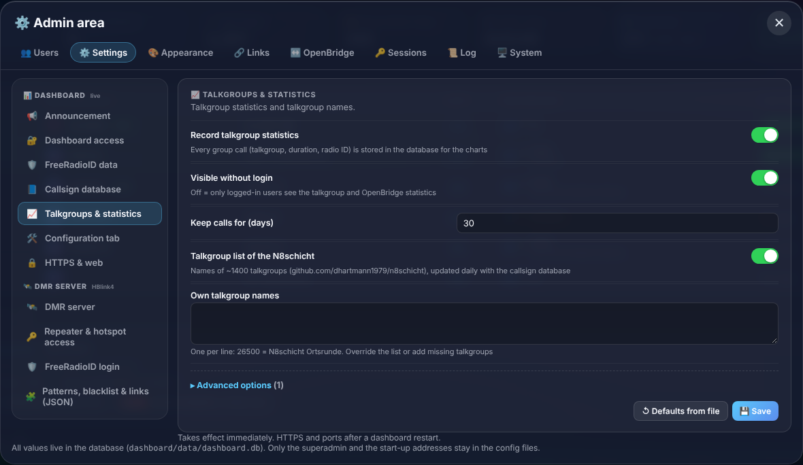
  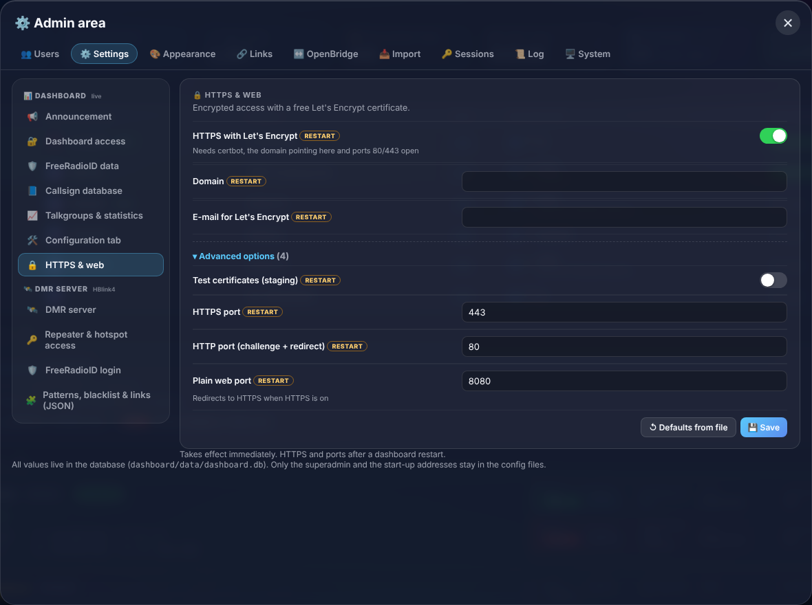

Die **Talkgroup-Namen** gelten für die Statistik, den Tab *Configuration* und den OpenBridge-Editor. Ältere Gespräche als die eingestellte Speicherdauer löscht das Dashboard jede Nacht. Ist die Statistik aus, wird nichts mehr gespeichert und der Tab **📈 Statistics** verschwindet.

### 🛰️ DMR-Server (HBlink4)

| Abschnitt | Einstellungen | Wirkt |
|---|---|---|
| 🛰️ DMR server | DMR-Port, Hang-Time; verpasste Pings, Timeouts und Reconnect-Logging unter *Advanced* | sofort; der **Port** erst nach Neustart des DMR-Servers |
| 🔑 Repeater & hotspot access | Standard-Passwort, Talkgroups TS1/TS2 (`all` = alle, `none` = keine), ob die Talkgroup-Liste des Geräts (RPTO) gilt, Einzelrufe | sofort für neue Anmeldungen; Talkgroups auch für verbundene Stationen ohne eigene Liste |
| 🛡️ FreeRadioID login | Secure Login an/aus, Gast-Talkgroups; API-Timeout unter *Advanced* | sofort |
| 🧩 Patterns, blacklist & links | eigene Regeln pro ID/Rufzeichen, Blacklist, Verbindungen zu anderen Servern, jeweils als JSON | Patterns und Blacklist sofort, Verbindungen nach Neustart |

OpenBridge-Trunks haben einen eigenen Bereich: [↔️ OpenBridge](#️-openbridge).

**So kommen die Änderungen beim DMR-Server an:** Beim Speichern schickt das Dashboard dem DMR-Server über ihre gemeinsame Verbindung den Befehl *Einstellungen übernehmen*. HBlink4 liest die Datenbank neu und meldet im Log `⚙️ Settings from the admin area applied`.
- **Neustart nötig:** Bei Port, Links oder Trunks erscheint ein Hinweis mit dem Knopf **Restart DMR server**.
- **DMR-Server nicht verbunden:** Läuft er gerade nicht, übernimmt er die Werte beim nächsten Start.

**Patterns und Trunks werden vor dem Speichern geprüft:** HBlink4 muss sie verstehen, sonst werden sie abgelehnt und die alten Werte bleiben. Beispiele stehen in [Konfiguration → Patterns](konfiguration.md#patterns-eigene-regeln-pro-repeater).

## 🎨 Appearance

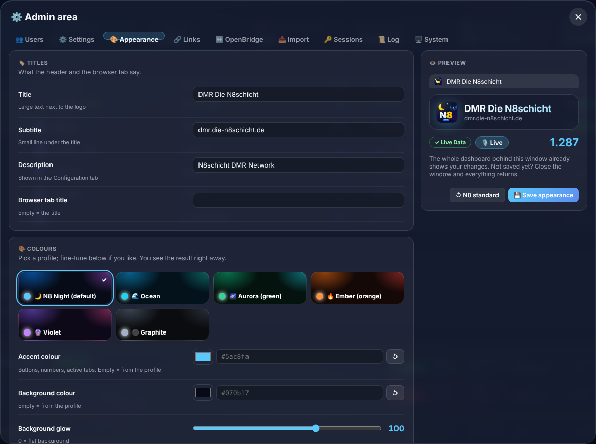
&nbsp;
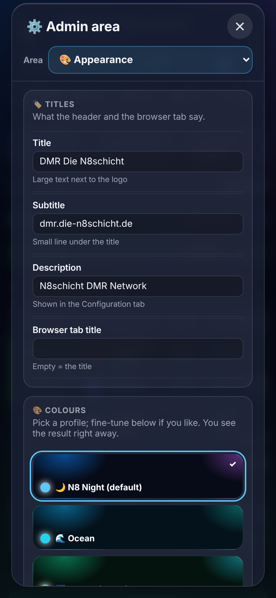

Rechts zeigt eine **Vorschau** Browser-Tab und Kopfzeile. Gleichzeitig ändert sich das ganze Dashboard hinter dem Fenster sofort mit. Was du nicht speicherst, verschwindet beim Schließen des Fensters wieder.

| Bereich | Einstellungen |
|---|---|
| 🏷️ **Titles** | **Title** (groß neben dem Logo), **Subtitle** (Zeile darunter), **Description** (im Tab *Configuration*), **Browser tab title** (leer = Title) |
| 🎨 **Colours** | **Farbprofil** per Klick: 🌙 N8 Night (Vorgabe), 🌊 Ocean, 🌌 Aurora, 🔥 Ember, 🔮 Violet, ⚫ Graphite. Fein einstellen mit **Accent colour** (Knöpfe, Zahlen, aktive Tabs), **Background colour**, **Background glow** (0 = flach), **Card brightness** und **Glass blur effect** (aus = schneller auf alten Handys). **↺** setzt eine Farbe zurück aufs Profil. |
| 🖼️ **Logo & browser icon** | **⬆️ Upload image**: PNG, JPEG, WebP, GIF oder SVG, höchstens 1 MB; das Favicon auch als ICO. Alternativ die Adresse eines Bildes. **↺ N8 logo** stellt das N8schicht-Logo wieder her. Dazu **Logo size** (24–96 px) und **Logo corners** (0 = wie gezeichnet, 50 = rund). |

  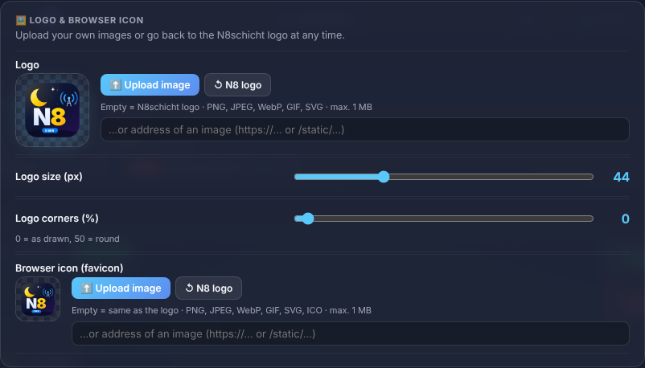

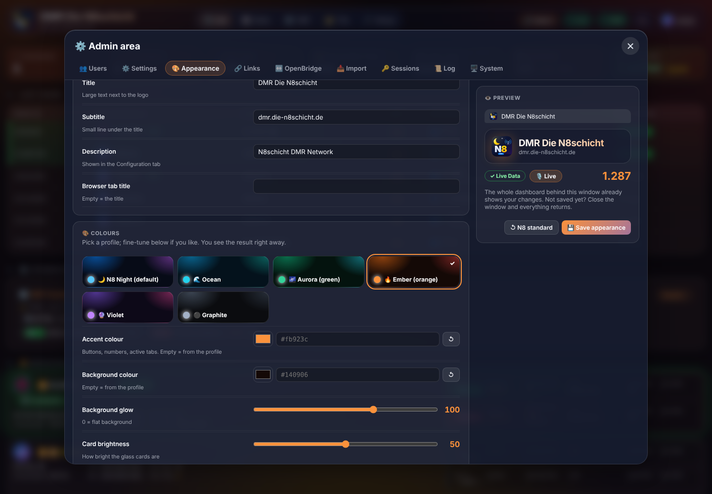

**↺ N8 standard** stellt Farben und Logo-Größe auf das N8-Design zurück. Hochgeladene Bilder liegen in der Datenbank und sind unter `/branding/logo` und `/branding/favicon` erreichbar. SVG-Dateien mit Skripten oder externen Links werden abgelehnt.

## 🔗 Links

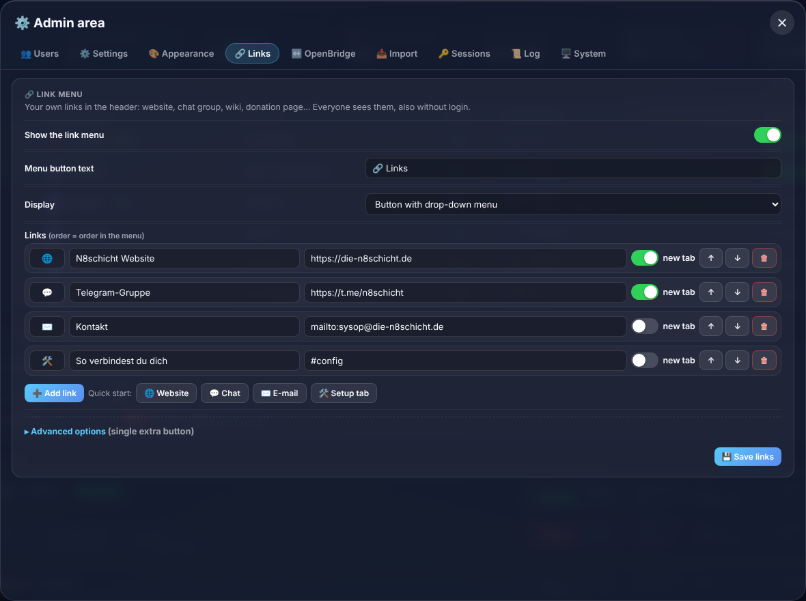

Eigene Links für alle Besucher, auch ohne Login: Webseite, Chat-Gruppe, Wiki, Kontakt.

- **Show the link menu** schaltet das Menü ein.
- **Menu button text**: Beschriftung des Knopfs, Vorgabe „🔗 Links“.
- **Display**: *Button with drop-down menu* (ein Knopf oben rechts mit aufklappender Liste) oder *Row of buttons under the header* (alle Links nebeneinander unter der Kopfzeile).
- **Links**: Emoji, Name, Adresse und ob der Link in einem neuen Tab öffnet. Mit **↑ ↓** sortieren, **🗑** löschen, **➕ Add link** oder die Schnellstart-Knöpfe (Website, Chat, E-Mail, Setup-Tab) zum Anlegen. Erlaubt sind `https://…`, `mailto:…`, Pfade wie `/static/…` und Tabs wie `#config`.
- Unter *Advanced* bleibt der frühere einzelne **Network-Info-Knopf**.

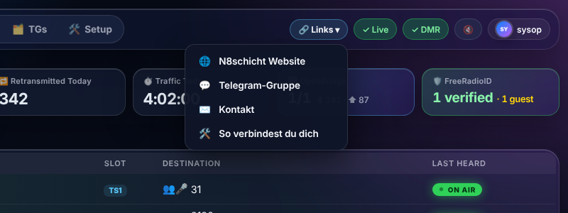

## ↔️ OpenBridge

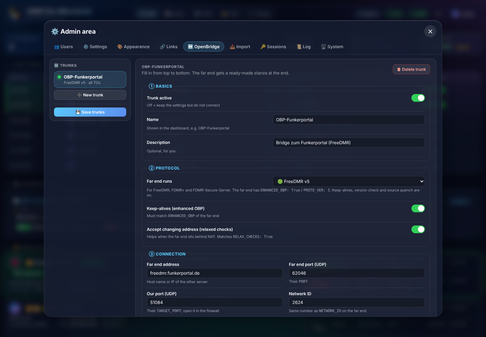
&nbsp;
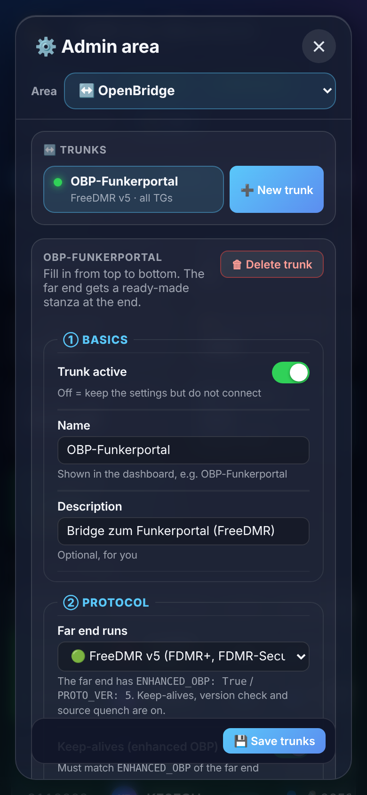

Trunks zu anderen Netzen richtest du hier in einem Formular ein, ohne JSON. Links stehen die Trunks (grün = aktiv), rechts der gewählte Trunk in fünf Schritten:

| Schritt | Inhalt |
|---|---|
| ① **Basics** | aktiv an/aus, Name, Beschreibung |
| ② **Protocol** | Auswahl **🟢 FreeDMR v5** (FDMR+, FDMR-Secure-Server; Vorgabe) oder **⚪ Classic OpenBridge** (Brandmeister, HBlink3). Bei FreeDMR erscheinen die Schalter *Keep-alives* und *Accept changing address*, bei Classic der Schalter *Send the real repeater ID*. |
| ③ **Connection** | Adresse und Port der Gegenstelle, unser Port, Netzwerk-ID, Passwort (bei FreeDMR mit Warnung ab 21 Zeichen); Bind-Adresse und Source-Server-ID unter *Advanced* |
| ④ **Talkgroups** | **🌐 All talkgroups – no filter** mit Wahl des Zeitschlitzes, oder **☑️ Only selected talkgroups** mit der Liste aller bekannten Talkgroups |
| ⑤ **For the far end** | fertiger Abschnitt für die `hblink.cfg` der Gegenstelle zum Kopieren; Ports über Kreuz, Protokoll und TG-Liste passend |

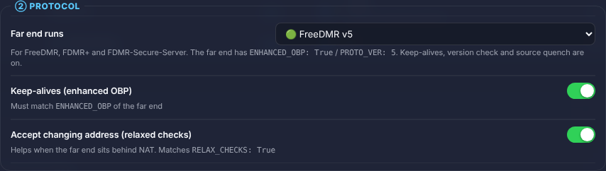

**Talkgroups auswählen:** Suche nach Nummer oder Name, Filter *All / Selected / Not selected*, Häkchen pro Talkgroup und der Zeitschlitz daneben. **Select all shown** übernimmt alle gerade angezeigten, z. B. alle Treffer für „deutsch“. Talkgroups, die nicht in der Liste stehen, fügst du mit **➕** hinzu. Ausgewählte stehen oben.

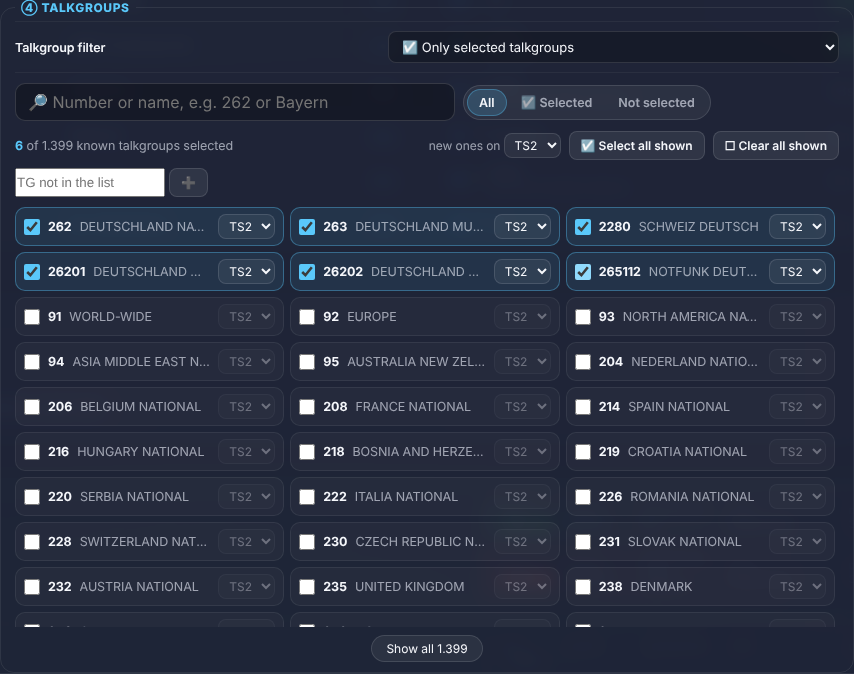

**Ohne Filter** laufen alle Talkgroups über den Trunk, außer den lokalen: 1–79, 4000, 5000 und 9990–9999. Das darf nur **ein** aktiver Trunk.

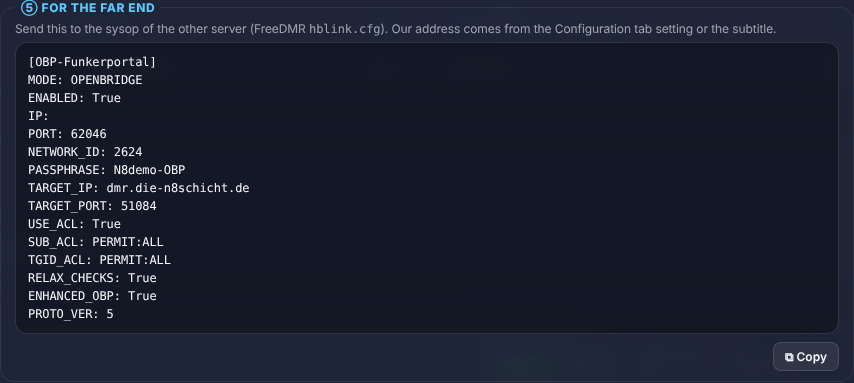

Unter **🧑‍💻 Expert: all trunks as JSON** stehen alle Trunks als JSON, zum Ansehen oder Einfügen; **⤴ Take over JSON into the form** übernimmt es ins Formular. **💾 Save trunks** prüft alles mit HBlink4 und speichert. Trunks ändern sich nach einem Neustart des DMR-Servers.

## 📥 Import

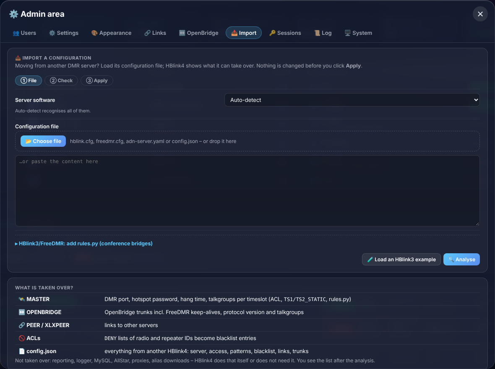
&nbsp;
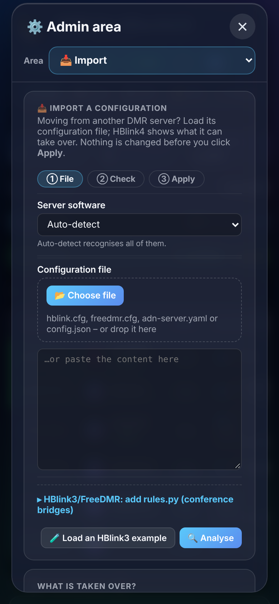

Der **Konfigurations-Konverter** übernimmt die Einstellungen eines anderen DMR-Servers:

| Server software | Datei |
|---|---|
| HBlink3 | `hblink.cfg` (+ optional `rules.py` mit den Konferenz-Brücken) |
| FreeDMR / FDMR+ / FDMR-Secure-Server | `hblink.cfg`, `freedmr.cfg` |
| ADN DMR Peer Server | `adn-server.yaml` |
| HBlink4 | `config/config.json` |

**Auto-detect** erkennt das Format selbst. Datei wählen, auf das Feld ziehen oder einfügen, dann **🔍 Analyse**. **🧪 Load an HBlink3 example** lädt die Beispieldatei aus [lz5pn/HBlink3](https://github.com/lz5pn/HBlink3) zum Ausprobieren.

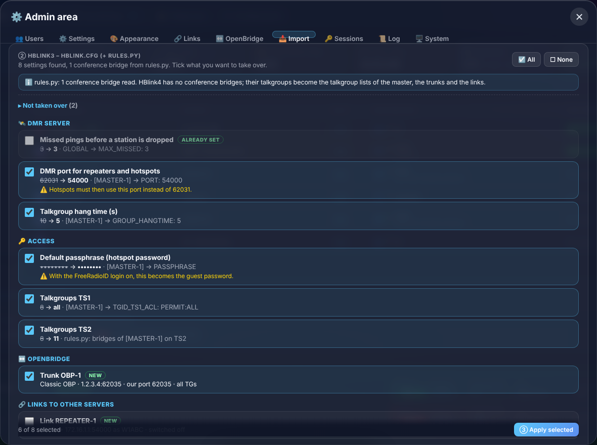

Das Ergebnis ist nach Bereichen sortiert (DMR server, Access, OpenBridge, Links, Blacklist). Jede Zeile zeigt:
- **alt → neu** und woher der Wert stammt, z. B. `[MASTER-1] → PORT: 54000`
- **⚠️ Hinweise** in Gelb, z. B. wenn sich der Hotspot-Port ändert
- **already set**, wenn der Wert schon stimmt (abgewählt)
- bei Trunks und Links **new** oder **replaces existing** (gleicher Name)

**Not taken over** listet die Abschnitte, die HBlink4 nicht braucht, jeweils mit Grund. **③ Apply selected** übernimmt die angehakten Zeilen; HBlink4 prüft sie wie beim normalen Speichern. Die Datei wird nur gelesen, nie ausgeführt.

Die genaue Umsetzung steht in [Anleitungen → Umziehen](anleitungen.md#2-von-hblink3-freedmr-oder-adn-umziehen).

## 🔑 Sessions, 📜 Log, 🖥️ System

  
  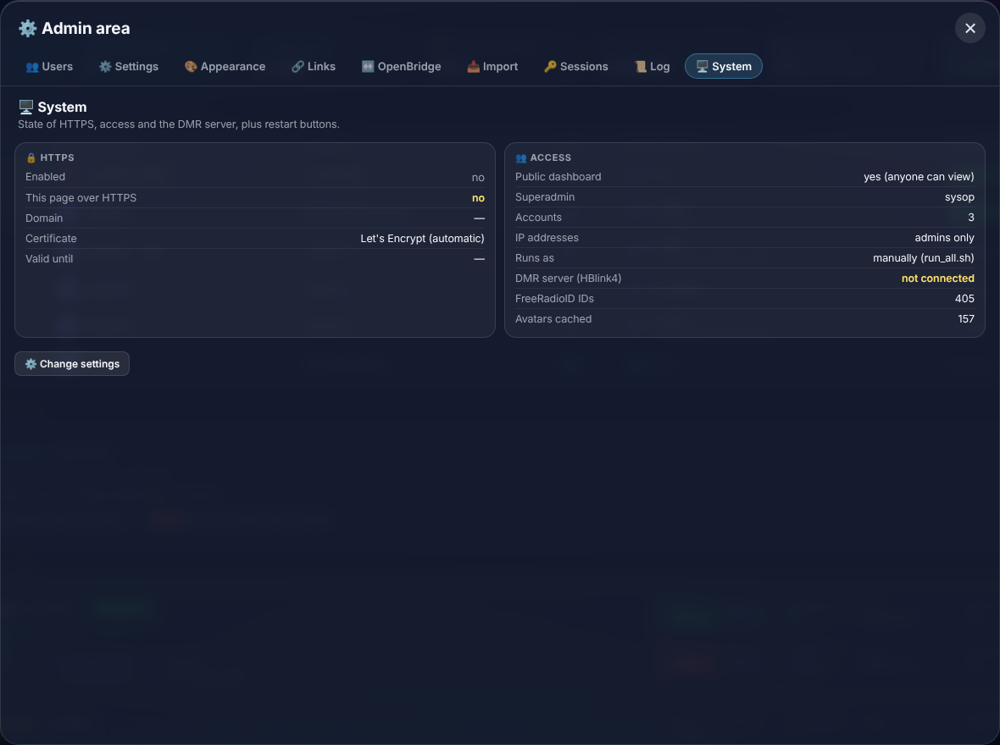

- **Sessions**: alle Anmeldungen mit IP, Browser und Ablauf; jede lässt sich beenden.
- **Log**: Anmeldungen, Fehlversuche, Benutzer- und Einstellungsänderungen, Neustarts, jeweils mit Zeit, Person und IP.
- **System**: HTTPS mit Ablaufdatum des Zertifikats, Zugriff, Verbindung zum DMR-Server, FreeRadioID-IDs und gespeicherte Avatare. Dazu die Knöpfe **Restart dashboard** und **Restart DMR server**; sie erscheinen nur, wenn beides als systemd-Dienst läuft.

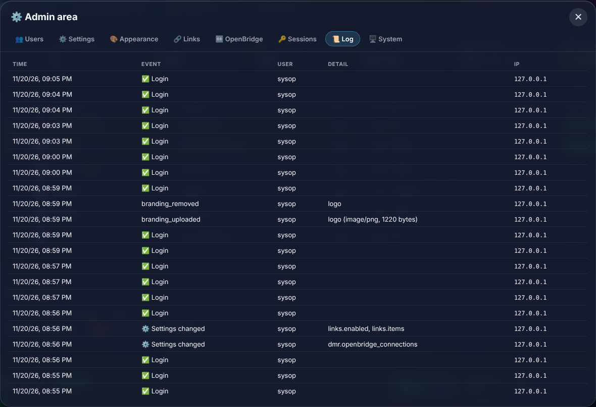

---

Weiter: [🧭 Anleitungen](anleitungen.md)
