# 🎙️ Dashboard

[← Übersicht](../../readme.md) · [Installation](installation.md) · **Dashboard** · [Adminbereich](adminbereich.md) · [Anleitungen](anleitungen.md) · [Konfiguration](konfiguration.md) · [FreeRadioID](freeradioid.md) · [Betrieb & Fehlersuche](betrieb.md)

---

  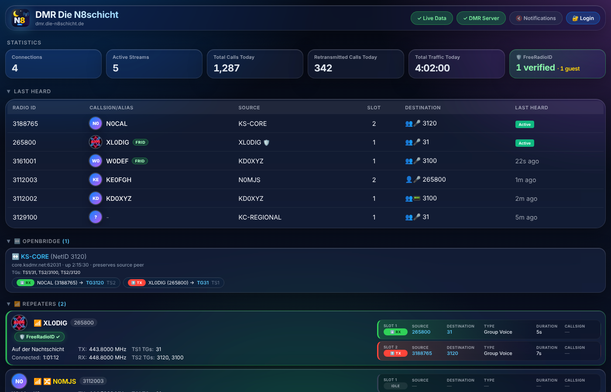
  &nbsp;
  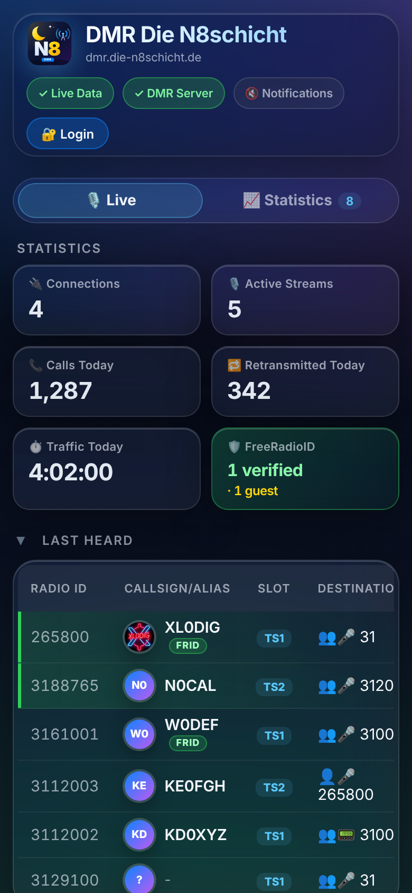

Das Dashboard zeigt live, was auf dem DMR-Server passiert. Es ist für Desktop und Smartphone gebaut; auf dem Handy rücken die Spalten zusammen und unwichtige Spalten verschwinden.

## Kopfzeile mit Menü

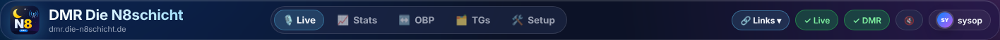

Die Kopfzeile bleibt beim Scrollen oben stehen. Das **Menü** (Live, Statistics, OpenBridge, Talkgroups, Configuration) ist Teil dieser festen Leiste: links Logo und Titel, in der Mitte das Menü, rechts die Status-Knöpfe. So wechselst du von überall die Ansicht, ohne nach oben zu scrollen.

- **Ab 1500 Pixel Breite:** Menü mit vollen Namen und den Zählern (z. B. *Statistics 8*).
- **1100–1500 Pixel:** kurze Namen (Stats, OBP, TGs, Setup); ab 1280 abwärts zeigt der Login-Knopf nur noch den Avatar.
- **Tablet:** Das Menü steht als eigene Zeile in derselben festen Leiste und nutzt die ganze Breite.
- **Smartphone:** nur eine Zeile plus Menü. Logo und Titel links, rechts 🔗, zwei **Statuspunkte** (Live und DMR: grün = verbunden, gelb = DMR-Server fehlt, rot = Verbindung weg), 🔇/🔊 und dein Avatar. So bleibt mehr Platz für den Inhalt.

Die Status-Knöpfe sind kurz gehalten: **✓ Live**, **✓ DMR**, 🔇/🔊. Der ausführliche Text steht im Tooltip.

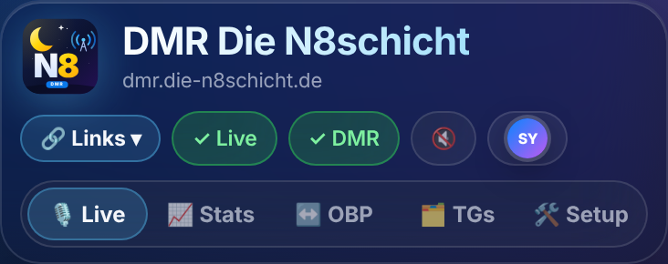

| Element | Bedeutung |
|---|---|
| Logo, Titel, Untertitel, Farben | einstellbar im Adminbereich unter [🎨 Appearance](adminbereich.md#-appearance) |
| **Menü** | 🎙️ Live · 📈 Statistics · ↔️ OpenBridge · 🗂️ Talkgroups · 🛠️ Configuration |
| **✓ Live** | Der Browser ist mit dem Dashboard verbunden (Live-Daten). Ein Klick verbindet neu. |
| **✓ DMR** | HBlink4, der DMR-Server, ist mit dem Dashboard verbunden. |
| **🔇 / 🔊** | Töne bei Verbindungen und Gesprächen an/aus |
| **🔗 Links** | eigenes Link-Menü, wenn im [Adminbereich](adminbereich.md#-links) eingerichtet; alternativ als Knopfreihe unter der Kopfzeile |
| **🔐 Login** bzw. Name | Anmelden; danach das Menü mit Adminbereich, Passwort und Abmelden |

## Statistik

🔌 Verbindungen (Repeater, Hotspots, Outbound-Links und aktive OpenBridge-Trunks) · 🎙️ laufende Gespräche · 📞 Gespräche heute · 🔁 weitergeleitet heute · ⏱️ Sprechzeit heute · ↔️ OpenBridge · 🛡️ FreeRadioID. Die Tageswerte werden um Mitternacht zurückgesetzt. Auf breiten Bildschirmen stehen alle Kacheln in einer Reihe, darunter vier pro Reihe. Am Smartphone stehen sechs gleich große Kacheln in zwei Reihen zu je drei; „weitergeleitet heute“ und die Zusatzzahlen von OpenBridge und FreeRadioID entfallen dort.

- **↔️ OpenBridge** zeigt aktive und eingerichtete Trunks (z. B. `1/1`) sowie die Gespräche von heute: ⬇ empfangen und ⬆ gesendet. Die Kachel erscheint nur, wenn ein Trunk eingerichtet ist. Ein Klick öffnet den [Tab OpenBridge](#️-openbridge--die-trunks-im-detail).
- **🛡️ FreeRadioID** zeigt verifizierte Stationen und Gäste. Die Kachel erscheint nur, wenn der FreeRadioID-Login aktiv ist.

## Tabs: 🎙️ Live, 📈 Statistics, ↔️ OpenBridge, 🗂️ Talkgroups, 🛠️ Configuration

Im Menü der Kopfzeile wählst du zwischen fünf Ansichten:

- **🎙️ Live**: alles, was gerade passiert, also Statistik, Last Heard und Verbindungen. Diese Ansicht ist der Start.
- **📈 Statistics**: die [Talkgroup-Statistik](#-talkgroup-statistik). Die Zahl am Tab gibt an, wie viele Talkgroups heute aktiv waren.
- **↔️ OpenBridge** (am Smartphone „OBP“): [die Trunks im Detail](#️-openbridge--die-trunks-im-detail). Die Zahl am Tab zeigt aktive und eingerichtete Trunks. Der Tab erscheint nur, wenn ein Trunk eingerichtet ist.
- **🗂️ Talkgroups** (am Smartphone „TGs“): [das Talkgroup-Verzeichnis](#️-talkgroups--das-verzeichnis) mit Suche.
- **🛠️ Configuration** (am Smartphone „Setup“): [alles, was man zum Verbinden braucht](#️-configuration--so-verbindest-du-dich).

Der gewählte Tab steht in der Adresse (`…/#stats`, `…/#openbridge`, `…/#talkgroups`, `…/#config`). So landest du nach dem Neuladen wieder dort und kannst die Tabs direkt verlinken, z. B. `https://dmr.die-n8schicht.de/#config` für neue Funkamateure.

## ↔️ OpenBridge – die Trunks im Detail

  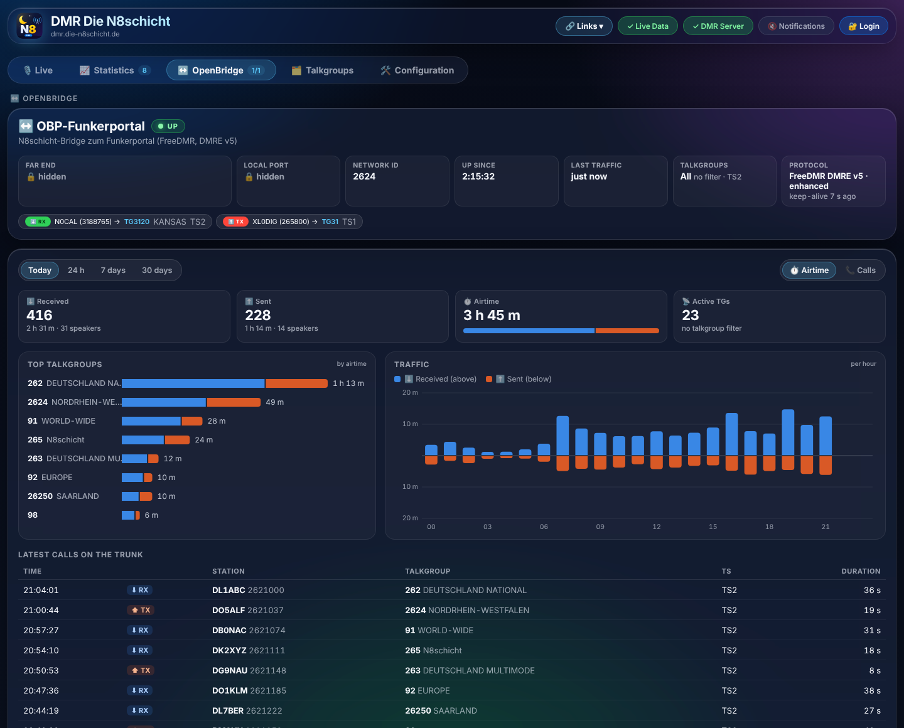
  &nbsp;
  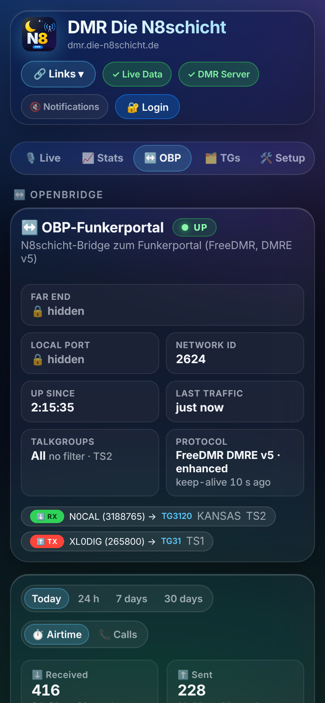

Ein OpenBridge-Trunk führt oft über tausend Talkgroups. In der Live-Ansicht steht deshalb nur eine kompakte Karte: Name, Netzwerk-ID, Gegenstelle, Laufzeit, die **Anzahl** der Talkgroups mit Zeitschlitz, die Gespräche von heute (⬇ empfangen, ⬆ gesendet) und die laufenden Gespräche. **Details ›** öffnet den Tab.

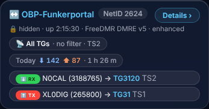

Die Karte ist so schmal wie die Stationskarten und steht mit ihnen im selben Raster; jedes laufende Gespräch ist eine eigene Zeile. Ein Klick auf den Sprecher öffnet seine [Stationsinfo](#stationsinfo-zu-jeder-dmr-id).

Im Tab **↔️ OpenBridge** steht alles zu einem Trunk. Bei mehreren Trunks wählst du oben den Trunk aus.

| Bereich | Inhalt |
|---|---|
| **Kopf** | Name, Beschreibung, **UP**/**DOWN**; Gegenstelle mit Port, lokaler UDP-Port, Netzwerk-ID, verbunden seit, letzter Verkehr, Anzahl Talkgroups, was als RptrId gesendet wird; darunter die laufenden Gespräche |
| **Zeitraum / Messgröße** | Heute · 24 h · 7 Tage · 30 Tage, ⏱️ Sprechzeit oder 📞 Gespräche |
| **Kennzahlen** | ⬇️ empfangen und ⬆️ gesendet (Gespräche, Sprechzeit, Sprecher), Sprechzeit gesamt mit Anteil empfangen/gesendet, aktive Talkgroups |
| **Top talkgroups** | die 10 meistgenutzten Talkgroups auf dem Trunk; blau = empfangen, orange = gesendet |
| **Traffic** | Verlauf pro Stunde oder Tag: empfangen über der Linie, gesendet darunter |
| **Latest calls on the trunk** | die letzten 25 Gespräche mit Richtung, Station, Talkgroup, Zeitschlitz und Dauer |
| **Talkgroups on the trunk** | die komplette Liste mit Namen und Zeitschlitz, mit Suche und Filtern (*Active*, *TS1*, *TS2*); aktive Talkgroups sind hervorgehoben |

  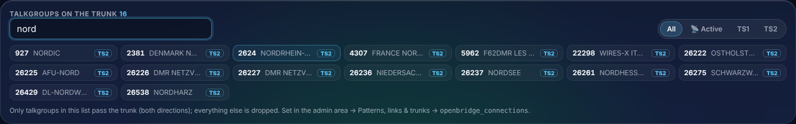

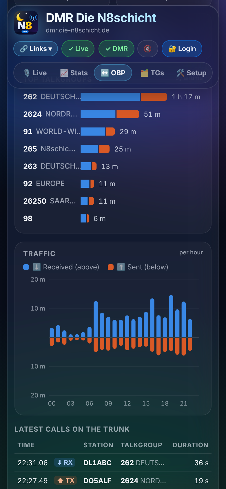

**Adressen und Ports** der Gegenstelle und unser lokaler Port sind nur für eingeloggte Admins sichtbar; alle anderen sehen **🔒 hidden**. Bei einem Trunk ohne Talkgroup-Filter steht „All TGs“ statt der Liste.

Jedes Gespräch über den Trunk wird mit Richtung, Talkgroup und Dauer in SQLite gespeichert, und zwar in beide Richtungen. Speicherdauer und Sichtbarkeit ohne Login sind dieselben wie bei der [Talkgroup-Statistik](#-talkgroup-statistik). Das Passwort (`passphrase`) des Trunks erscheint nirgends im Dashboard.

Eingerichtet wird ein Trunk im [Adminbereich unter ↔️ OpenBridge](adminbereich.md#️-openbridge): entweder mit allen Talkgroups ohne Filter oder nur mit ausgewählten. Bei ausgewählten Talkgroups verwirft HBlink4 alle anderen in beide Richtungen.

## 🗂️ Talkgroups – das Verzeichnis

  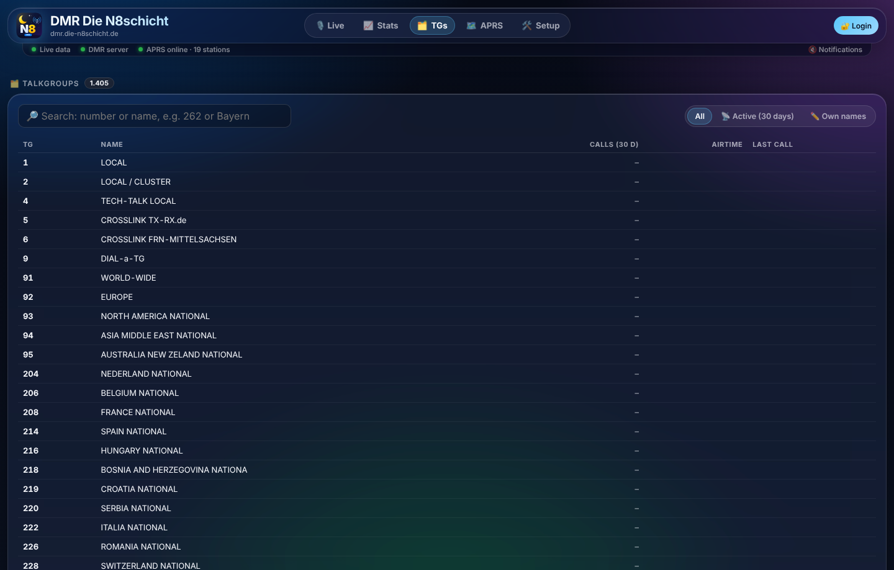
  &nbsp;
  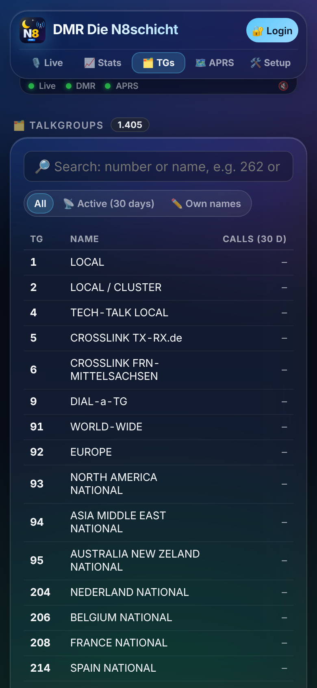

Alle Talkgroups mit Namen aus der **Talkgroup-Liste der N8schicht** ([`talkgroup_ids.json`](https://github.com/dhartmann1979/n8schicht/blob/main/talkgroup_ids.json), rund 1.400 Einträge) und den eigenen Namen aus dem Adminbereich (*own*).

- **Suche** nach Nummer (Anfang, z. B. `262`) oder Namen (z. B. `Bayern`, `nord`)
- **📡 Active (30 days)**: nur Talkgroups, auf denen der Server in den letzten 30 Tagen Gespräche hatte, sortiert nach Sprechzeit; mit Gesprächen, Sprechzeit und letztem Gespräch
- **✏️ Own names**: nur die selbst vergebenen Namen

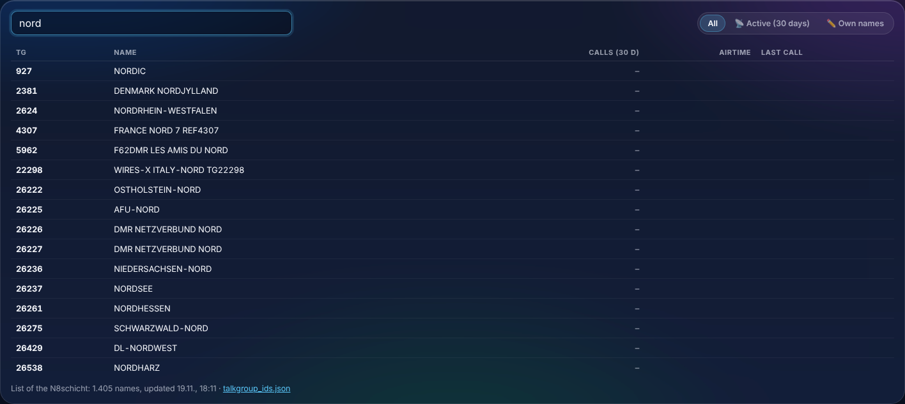

Die Namen erscheinen auch überall sonst im Dashboard:
- **Last Heard:** unter der Talkgroup-Nummer
- **Zeitschlitze der Karten:** unter *Destination*
- **TS1/TS2-Listen der Karten:** als Tooltip; gepunktet unterstrichene Nummern haben einen Namen
- **Detailansicht** der Stationen
- **Talkgroup-Statistik** und **Configuration-Tab**

Die Liste wird täglich zusammen mit der Rufzeichen-Datenbank neu geladen. Bis zum ersten Download nutzt das Dashboard eine mitgelieferte Kopie, die Namen funktionieren also sofort und auch offline.

## 🛠️ Configuration – so verbindest du dich

  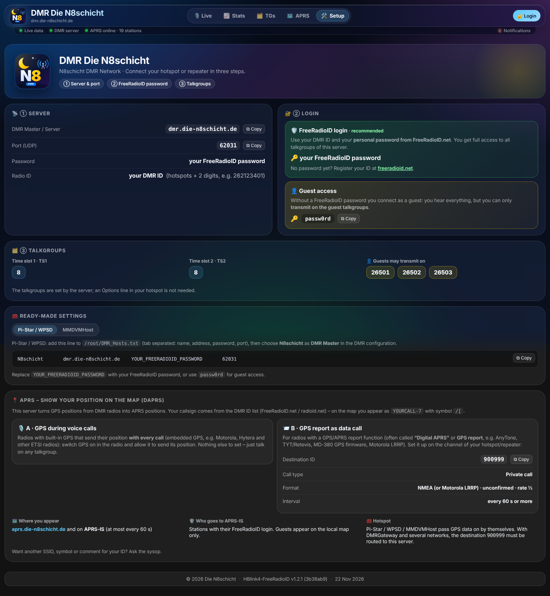
  &nbsp;
  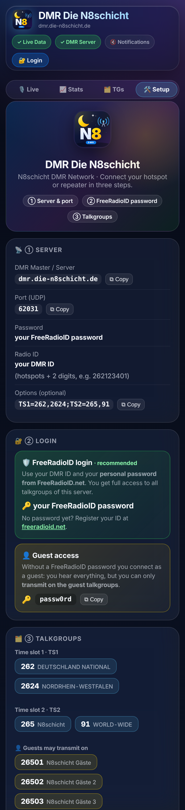

Der Tab erklärt mit dem N8schicht-Logo in drei Schritten, wie ein Hotspot oder Repeater auf den Server kommt. Alle Werte kommen live aus dem Adminbereich, sie stimmen also immer:

| Karte | Inhalt |
|---|---|
| **① Server** | Adresse und UDP-Port mit **⧉ Copy**-Knopf, Passwort-Hinweis, Radio-ID (Hotspots mit zwei Ziffern Suffix); die *Options*-Zeile nur, wenn Geräte ihre Talkgroups selbst wählen dürfen (`trust`) |
| **② Login** | 🛡️ **FreeRadioID** (empfohlen): eigene DMR-ID und persönliches Passwort von FreeRadioID.net, volle Rechte, mit Link zur Registrierung · 👤 **Gast**: das Standard-Passwort, senden nur auf die Gast-Talkgroups. Ohne FreeRadioID-Login steht hier nur das Passwort. |
| **③ Talkgroups** | TS1, TS2 und die Gast-Talkgroups als Kacheln, mit den Namen aus dem Adminbereich |
| **🧰 Ready-made settings** | fertige Zeile für Pi-Star/WPSD (`/root/DMR_Hosts.txt`) und der Abschnitt `[DMR Network]` für MMDVMHost, je zum Kopieren |
| **📌 Note from the sysop** | freier Text aus dem Adminbereich, z. B. Regeln und Kontakt; Links werden klickbar |

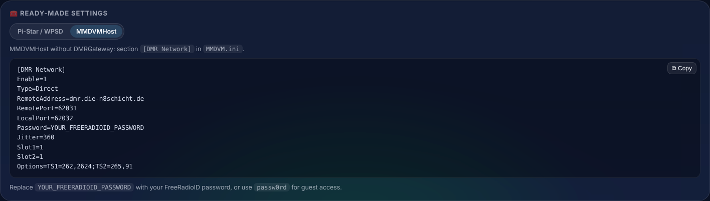

Ob der Tab erscheint, welche Adresse er zeigt, ob das Standard-Passwort zu sehen ist und welcher Hinweis darunter steht, stellst du im [Adminbereich](adminbereich.md#-dashboard) ein. Sonst steht dort „ask the sysop“. Eigene Passwörter aus Patterns zeigt der Tab nie.

## 📈 Talkgroup-Statistik

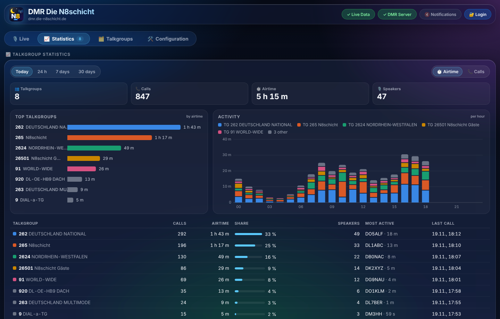

Der Tab **📈 Statistics** zeigt, **welche Talkgroups wie viel genutzt werden**. Jedes Gruppengespräch wird mit Talkgroup, Dauer und DMR-ID in SQLite gespeichert. Weitergeleitete Kopien desselben Gesprächs zählen nicht doppelt, Einzelrufe und Datenrufe zählen nicht mit.

| Element | Inhalt |
|---|---|
| **Zeitraum** | Heute · 24 h · 7 Tage · 30 Tage |
| **Messgröße** | ⏱️ Sprechzeit oder 📞 Anzahl Gespräche; gilt für beide Diagramme |
| **Kennzahlen** | aktive Talkgroups, Gespräche, Sprechzeit, verschiedene Sprecher im Zeitraum |
| **Top talkgroups** | die 10 meistgenutzten Talkgroups als Balken, mit Namen |
| **Activity** | Verlauf pro Stunde (Heute, 24 h) bzw. pro Tag (7/30 Tage); die 5 größten Talkgroups farbig, der Rest grau als „other“ |
| **Where the calls come from** | Anteil der Gespräche von lokalen Repeatern und Hotspots, über OpenBridge und über Outbound-Links |
| **Tabelle** | alle Talkgroups mit Gesprächen, Sprechzeit, Anteil, Sprechern, aktivster Station und letztem Gespräch; **↔ 40 %** zeigt, welcher Anteil der Sprechzeit über OpenBridge kam |

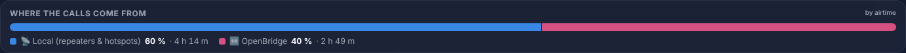

Gespräche über OpenBridge zählen in der Statistik mit, wenn sie hereinkommen. Was der Server selbst über den Trunk hinausschickt, ist eine Kopie eines Gesprächs, das schon gezählt ist; es steht im Tab OpenBridge als „gesendet“.

Fährst du mit der Maus über eine Säule oder einen Balken, erscheinen die genauen Werte. Eine Talkgroup behält ihre Farbe, auch wenn du den Zeitraum wechselst. Die Ansicht aktualisiert sich nach jedem Gespräch von selbst.

  
  &nbsp;
  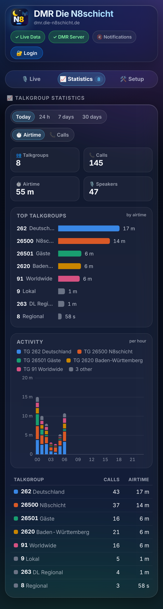

Auf dem Smartphone liegen die Diagramme untereinander, und die Tabelle zeigt nur Talkgroup, Gespräche und Sprechzeit. Namen für die Talkgroups, die Speicherdauer und ob der Tab ohne Login sichtbar ist, stellst du im [Adminbereich](adminbereich.md#-dashboard) ein.

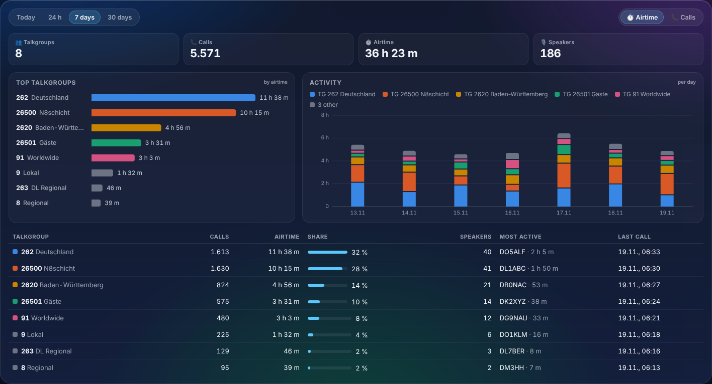

## ON AIR – wer spricht, steht oben

- **Last Heard:** Wer gerade spricht, steht in der ersten Zeile, grün hinterlegt und mit **● ON AIR**.
- **Repeater und Hotspots:** Die Station, die gerade sendet, rückt an den Anfang ihrer Gruppe. Ihre Karte leuchtet grün und trägt **ON AIR**.
- **Reihenfolge:** Danach folgen Stationen mit reservierter Talkgroup (Hang-Time), dann der Rest alphabetisch.

## Last Heard

  
  &nbsp;
  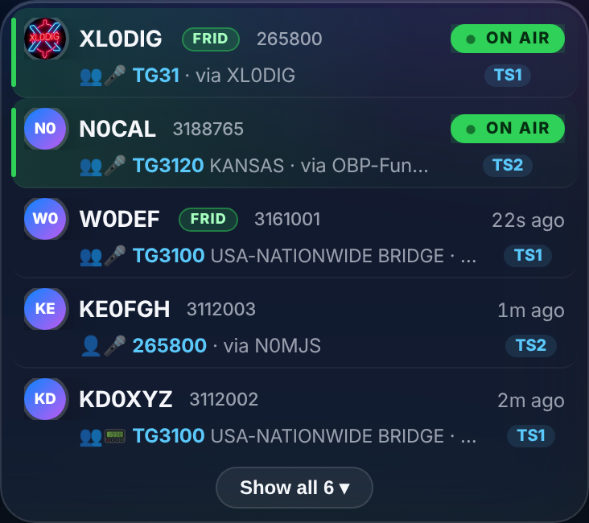

Jeder Eintrag ist eine kompakte Zeile. Am Desktop steht alles in einer Zeile, am Smartphone in zwei kurzen Zeilen (oben Rufzeichen, ID und Zeit, unten Talkgroup, Zeitschlitz und woher).

| Spalte | Inhalt |
|---|---|
| Radio ID | DMR-ID des Sprechers |
| Callsign | Avatar von FreeRadioID (sonst Initialen), Rufzeichen und **FRID**, wenn die ID bei FreeRadioID.net registriert ist |
| Source | über welchen Repeater oder welche Verbindung das Gespräch kam; 🛡️ = per FreeRadioID angemeldet |
| TS | Zeitschlitz TS1 oder TS2 |
| Destination | 👥 Gruppenruf / 👤 Einzelruf, 🎤 Sprache / 📟 Daten, Talkgroup mit Namen |
| Last heard | **ON AIR** oder vor wie vielen Sekunden/Minuten |

Damit die Liste nicht die halbe Seite füllt, stehen am Desktop die ersten **8**, am Smartphone die ersten **5** Einträge da. **Show all** zeigt alle zehn, **Show less** klappt wieder ein. Wer gerade spricht, steht immer oben und wird nie ausgeblendet.

Klappst du **Last Heard** über den Pfeil zu, siehst du nur die laufenden Gespräche.

Ein Klick auf **Radio ID** oder **Callsign** öffnet die [Stationsinfo](#stationsinfo-zu-jeder-dmr-id).

## Stationsinfo zu jeder DMR-ID

  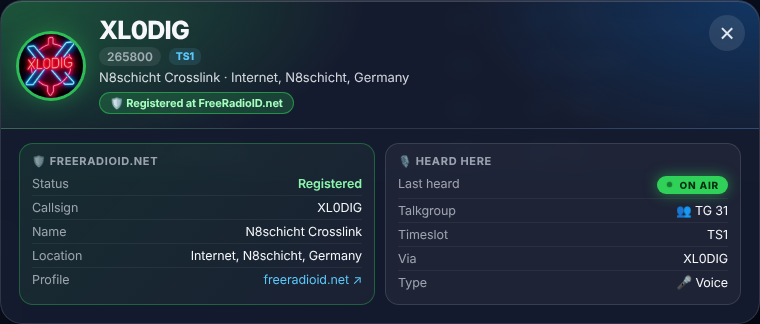
  &nbsp;
  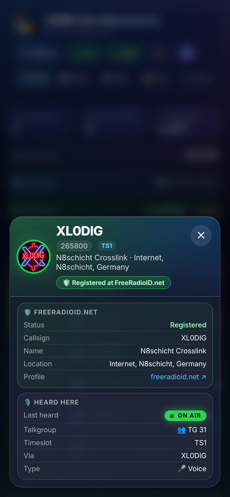

Überall, wo ein Sprecher auftaucht, kannst du ihn anklicken: in **Last Heard**, in den Zeitschlitz-Zeilen der Stationskarten, bei den laufenden Gesprächen auf OpenBridge und in der Gesprächsliste im Tab OpenBridge. Die Infos kommen von **FreeRadioID.net**:

| Bereich | Inhalt |
|---|---|
| Kopf | Avatar, Rufzeichen, DMR-ID, Name und Ort, ob die ID bei FreeRadioID.net registriert ist |
| 🛡️ FreeRadioID.net | Status, Rufzeichen, Name, Ort, Bemerkung und der Link zum Profil. Kennt FreeRadioID die ID nicht, steht das Rufzeichen aus der Rufzeichen-Datenbank da |
| 🎙️ Heard here | wann die ID zuletzt auf diesem Server gehört wurde (oder **ON AIR**), Talkgroup, Zeitschlitz, über welche Station, Sprache oder Daten |

Ist die ID selbst als Station hier angemeldet (Repeater, Hotspot, App), führt **Station logged in here – details ›** zur [Detailansicht](#detailansicht). Die Abfrage bei FreeRadioID.net wird eine Stunde zwischengespeichert; IP-Adressen stehen in der Stationsinfo nie.

## Fußzeile

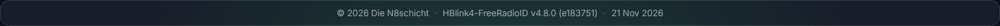

Am Ende jeder Seite steht **© Die N8schicht** mit der installierten Version (Versionsnummer und Commit) und ihrem Datum. So sieht man auf einen Blick, welcher Stand läuft.

## Repeater, Hotspots, Verbindungen

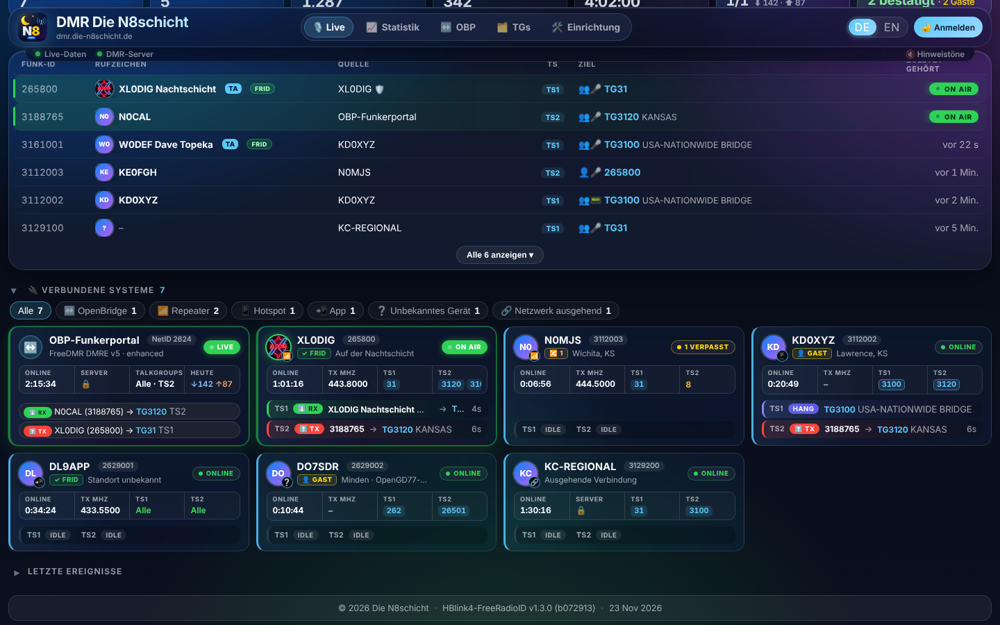

Repeater, Hotspots, Apps, Netzwerke, Outbound-Links und OpenBridge stehen als **schmale Karten nebeneinander**. Ab 1280 Pixel Breite stehen die Bereiche zusätzlich in **zwei Spalten** (ab 2100 Pixel in drei), mit je zwei Karten pro Reihe; am Tablet zwei Karten, am Smartphone eine. So passen viele Stationen auf einen Blick, ohne lange zu scrollen.

Jede Karte zeigt Avatar, Rufzeichen, DMR-ID, Standort, Frequenzen und die Talkgroups pro Zeitschlitz. Darunter stehen die Zeitschlitze als kurze Zeilen:
- Sind beide frei, ist es eine Zeile: `TS1 IDLE · TS2 IDLE`.
- Läuft ein Gespräch, zeigt die Zeile **⬇️ RX** (empfangen) oder **⬆️ TX** (gesendet), den Sprecher, die Talkgroup mit Namen und die Dauer.
- In der Nachlaufzeit (**HANG**) steht nur die Talkgroup.
- Ein Klick auf den Sprecher öffnet die [Stationsinfo](#stationsinfo-zu-jeder-dmr-id), ein Klick auf Avatar oder Rufzeichen der Karte die [Detailansicht](#detailansicht).

Die Login-Art erkennst du am Badge und an der Farbe:

| Anzeige | Bedeutung |
|---|---|
|  | **🛡️ FreeRadioID ✓**, grüner Rand: Die Station hat sich mit ihrem FreeRadioID-Passwort angemeldet und hat volle Rechte. |
| 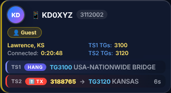 | **👤 Guest**, gelber Rand: Die Station hat sich mit dem Standard-Passwort angemeldet. Sie darf nur auf die Gast-Talkgroups senden, empfangen kann sie alles. |
| ohne Badge | angemeldet mit dem Passwort eines eigenen Patterns, bei dem FreeRadioID aus ist |

### Gerätearten: Repeater, Hotspot, App

HBlink4 sortiert jede Station anhand des **Paketnamens**, den ihre Software beim Login meldet (steht in der Detailansicht unter *Connection → Package*):

| Symbol | Bereich | Was ist das? | Beispiele für den Paketnamen |
|---|---|---|---|
| 📶 | **Repeaters** | Relaisstation mit eigener Hardware | `MMDVM`, `…Repeater`, `STM32…` |
| 📱 | **Hotspots** | persönliches Funkmodem, meist mit Pi-Star oder WPSD | `MMDVM_HS_Hat`, `ZUMspot`, `DVMega`, `MMDVM_DMO` |
| 📲 | **Apps** | Handy- oder PC-App **ohne Funkgerät** | `Z3DMR`, `DroidStar`, `BlueDV`, `DVSM`, `Peanut` |
| 🔗 | **Network Inbound** | ein anderer Server verbindet sich hierher | `HBlink`, `FreeDMR`, `BrandMeister` |
| ❔ | **Unknown device type** | Paketname steht in keiner Liste | – |

  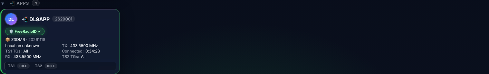
  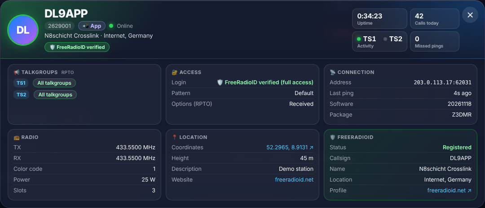

Bei Apps und unbekannten Geräten steht unter dem Rufzeichen die gemeldete Software (📦 Paketname · Version). Früher stand hier ein rotes **❓ Other** – das hieß nur „Paketname unbekannt“, nicht „Fehler“. Jetzt heißt der Bereich **❔ Unknown device type**, ist grau statt rot und nennt den gemeldeten Namen:

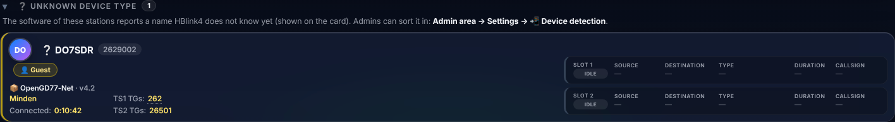

Ein Admin sortiert solche Geräte unter **Adminbereich → Settings → 📲 Device detection** ein (siehe [Adminbereich](adminbereich.md#️-dmr-server-hblink4)). Verbundene Stationen wandern nach dem Speichern sofort in den richtigen Bereich.

> **Hinweis DroidStar:** DroidStar meldet ab Werk den Paketnamen `MMDVM_MMDVM_HS_Hat` und sieht damit für den Server genau wie ein Hotspot aus. Als App erscheint es nur, wenn in DroidStar ein eigener Paketname eingetragen ist (z. B. `DroidStar`). Z3DMR meldet sich korrekt als `Z3DMR`.

Gold markierte Talkgroups werden für diese Station übersetzt (🔀). **OpenBridge** und **Network Outbound** zeigen Verbindungen zu anderen Servern. Bei OpenBridge steht statt der langen Talkgroup-Liste nur die Anzahl; alles Weitere zeigt der [Tab OpenBridge](#️-openbridge--die-trunks-im-detail).

## Detailansicht

Ein Klick auf Rufzeichen oder Avatar öffnet die Details:

  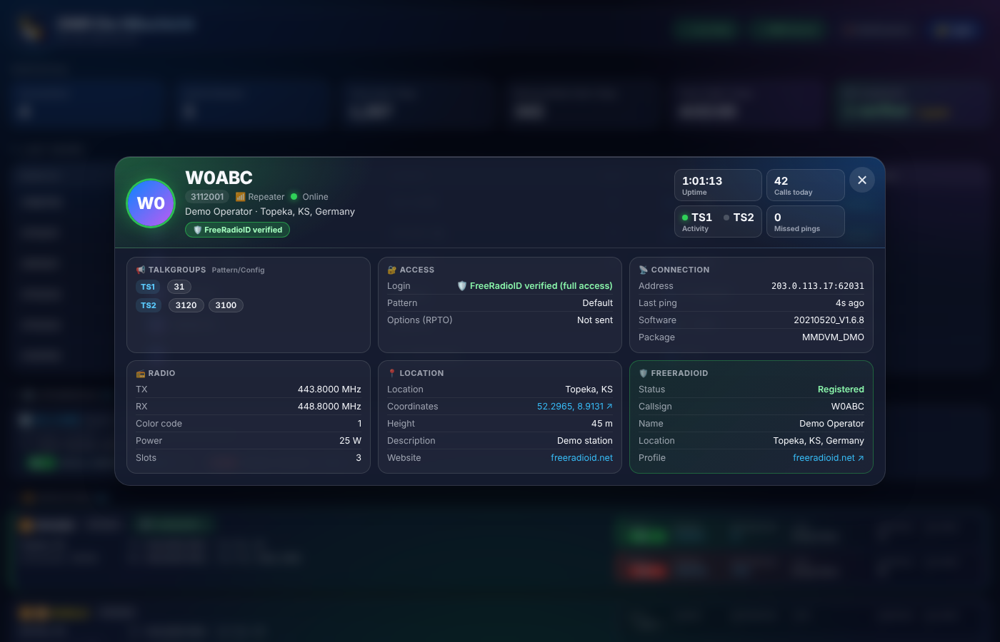
  &nbsp;
  

- **Kopf**: Avatar, Rufzeichen, ID, Typ, online, Name und Ort aus dem FreeRadioID-Profil, Login-Art
- **Kennzahlen**: Uptime, Gespräche heute, Aktivität TS1/TS2, verpasste Pings
- **Kacheln**: Talkgroups, Zugang, Verbindung, Funkdaten, Standort mit Link zu OpenStreetMap, FreeRadioID-Profil

Die **IP-Adresse** steht nur für eingeloggte Admins in der Kachel *Connection*. Alle anderen sehen *🔒 hidden*. Schließen mit `Esc`, ✕ oder einem Klick daneben.

---

Weiter: [⚙️ Adminbereich](adminbereich.md)
