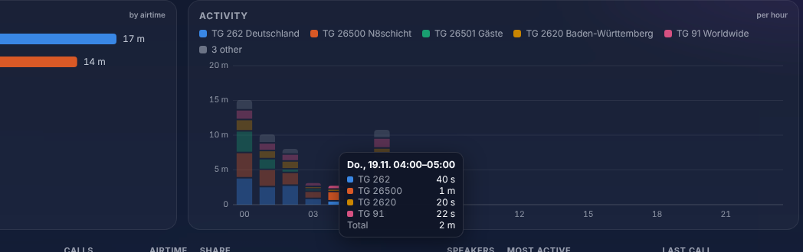
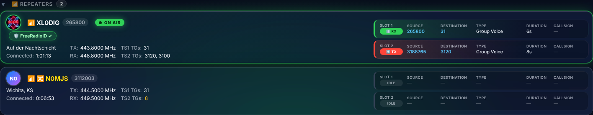
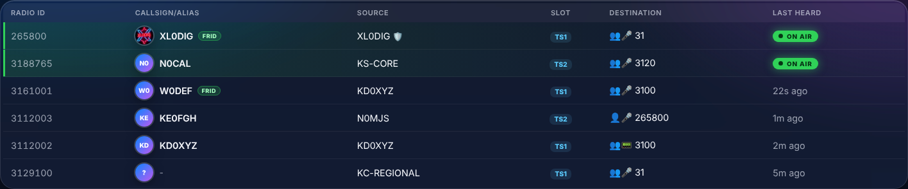
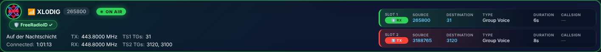
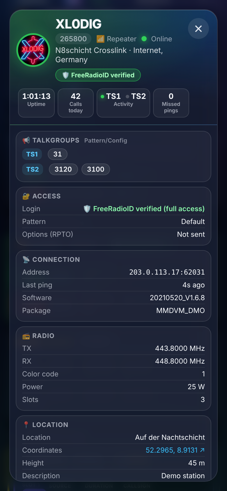

# 🎙️ Dashboard

[← Übersicht](../../readme.md) · [Installation](installation.md) · **Dashboard** · [Adminbereich](adminbereich.md) · [Konfiguration](konfiguration.md) · [FreeRadioID](freeradioid.md) · [Betrieb & Fehlersuche](betrieb.md)

---

  
  &nbsp;
  

Das Dashboard zeigt live, was auf dem DMR-Server passiert. Es ist für Desktop und Smartphone gebaut; auf dem Handy rücken die Spalten zusammen und unwichtige Spalten verschwinden.

## Kopfzeile

| Element | Bedeutung |
|---|---|
| Logo, Titel, Untertitel | einstellbar im Adminbereich (Settings → General) |
| **✓ Live Data** | Der Browser ist mit dem Dashboard verbunden. Ein Klick verbindet neu. |
| **✓ DMR Server** | HBlink4 ist mit dem Dashboard verbunden. |
| **🔇 Notifications** | Töne bei Verbindungen und Gesprächen an/aus |
| **🔐 Login** bzw. Name | Anmelden; danach das Menü mit Adminbereich, Passwort und Abmelden |

## Statistik

🔌 Verbindungen · 🎙️ laufende Gespräche · 📞 Gespräche heute · 🔁 weitergeleitet heute · ⏱️ Sprechzeit heute · 🛡️ FreeRadioID: verifizierte Stationen und Gäste. Diese Kachel erscheint nur, wenn der FreeRadioID-Login aktiv ist. Die Tageswerte werden um Mitternacht zurückgesetzt.

## Tabs: 🎙️ Live und 📈 Statistics

Unter der Kopfzeile wählst du zwischen zwei Ansichten:

- **🎙️ Live**: alles, was gerade passiert, also Statistik, Last Heard und Verbindungen. Diese Ansicht ist der Start.
- **📈 Statistics**: die Talkgroup-Statistik. Die Zahl am Tab gibt an, wie viele Talkgroups heute aktiv waren.

Der gewählte Tab steht in der Adresse (`…/#stats`). So landest du nach dem Neuladen wieder dort und kannst die Statistik direkt verlinken.

## 📈 Talkgroup-Statistik

Der Tab **📈 Statistics** zeigt, **welche Talkgroups wie viel genutzt werden**. Jedes Gruppengespräch wird mit Talkgroup, Dauer und DMR-ID in SQLite gespeichert. Weitergeleitete Kopien desselben Gesprächs zählen nicht doppelt, Einzelrufe und Datenrufe zählen nicht mit.

| Element | Inhalt |
|---|---|
| **Zeitraum** | Heute · 24 h · 7 Tage · 30 Tage |
| **Messgröße** | ⏱️ Sprechzeit oder 📞 Anzahl Gespräche; gilt für beide Diagramme |
| **Kennzahlen** | aktive Talkgroups, Gespräche, Sprechzeit, verschiedene Sprecher im Zeitraum |
| **Top talkgroups** | die 10 meistgenutzten Talkgroups als Balken, mit Namen |
| **Activity** | Verlauf pro Stunde (Heute, 24 h) bzw. pro Tag (7/30 Tage); die 5 größten Talkgroups farbig, der Rest grau als „other“ |
| **Tabelle** | alle Talkgroups mit Gesprächen, Sprechzeit, Anteil, Sprechern, aktivster Station und letztem Gespräch |

Fährst du mit der Maus über eine Säule oder einen Balken, erscheinen die genauen Werte. Eine Talkgroup behält ihre Farbe, auch wenn du den Zeitraum wechselst. Die Ansicht aktualisiert sich nach jedem Gespräch von selbst.

  
  &nbsp;
  

Auf dem Smartphone liegen die Diagramme untereinander, und die Tabelle zeigt nur Talkgroup, Gespräche und Sprechzeit. Namen für die Talkgroups, die Speicherdauer und ob der Tab ohne Login sichtbar ist, stellst du im [Adminbereich](adminbereich.md#-dashboard) ein.

## ON AIR – wer spricht, steht oben

- **Last Heard:** Wer gerade spricht, steht in der ersten Zeile, grün hinterlegt und mit **● ON AIR**.
- **Repeater und Hotspots:** Die Station, die gerade sendet, rückt an den Anfang ihrer Gruppe. Ihre Karte leuchtet grün und trägt **ON AIR**.
- **Reihenfolge:** Danach folgen Stationen mit reservierter Talkgroup (Hang-Time), dann der Rest alphabetisch.

## Last Heard

| Spalte | Inhalt |
|---|---|
| Radio ID | DMR-ID des Sprechers |
| Callsign | Avatar von FreeRadioID (sonst Initialen), Rufzeichen und **FRID**, wenn die ID bei FreeRadioID.net registriert ist |
| Source | über welchen Repeater oder welche Verbindung das Gespräch kam; 🛡️ = per FreeRadioID angemeldet |
| Slot | Zeitschlitz TS1 oder TS2 |
| Destination | 👥 Gruppenruf / 👤 Einzelruf, 🎤 Sprache / 📟 Daten, Talkgroup |
| Last Heard | **ON AIR** oder vor wie vielen Sekunden/Minuten |

Klappst du **Last Heard** über den Pfeil zu, siehst du nur die laufenden Gespräche.

## Repeater, Hotspots, Verbindungen

Jede Karte zeigt Avatar, Rufzeichen, DMR-ID, Standort, Frequenzen, die Talkgroups pro Zeitschlitz und rechts den aktuellen Zustand beider Zeitschlitze. Die Login-Art erkennst du am Badge und an der Farbe:

| Anzeige | Bedeutung |
|---|---|
|  | **🛡️ FreeRadioID ✓**, grüner Rand: Die Station hat sich mit ihrem FreeRadioID-Passwort angemeldet und hat volle Rechte. |
|  | **👤 Guest**, gelber Rand: Die Station hat sich mit dem Standard-Passwort angemeldet. Sie darf nur auf die Gast-Talkgroups senden, empfangen kann sie alles. |
| ohne Badge | angemeldet mit dem Passwort eines eigenen Patterns, bei dem FreeRadioID aus ist |

Gold markierte Talkgroups werden für diese Station übersetzt (🔀). **OpenBridge** und **Network Outbound** zeigen Verbindungen zu anderen Servern.

## Detailansicht

Ein Klick auf Rufzeichen oder Avatar öffnet die Details:

  
  &nbsp;
  

- **Kopf**: Avatar, Rufzeichen, ID, Typ, online, Name und Ort aus dem FreeRadioID-Profil, Login-Art
- **Kennzahlen**: Uptime, Gespräche heute, Aktivität TS1/TS2, verpasste Pings
- **Kacheln**: Talkgroups, Zugang, Verbindung, Funkdaten, Standort mit Link zu OpenStreetMap, FreeRadioID-Profil

Die **IP-Adresse** steht nur für eingeloggte Admins in der Kachel *Connection*. Alle anderen sehen *🔒 hidden*. Schließen mit `Esc`, ✕ oder einem Klick daneben.

---

Weiter: [⚙️ Adminbereich](adminbereich.md)
