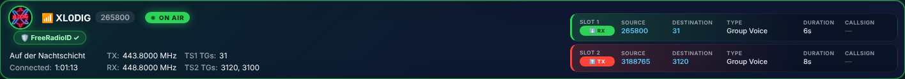
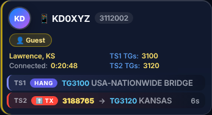
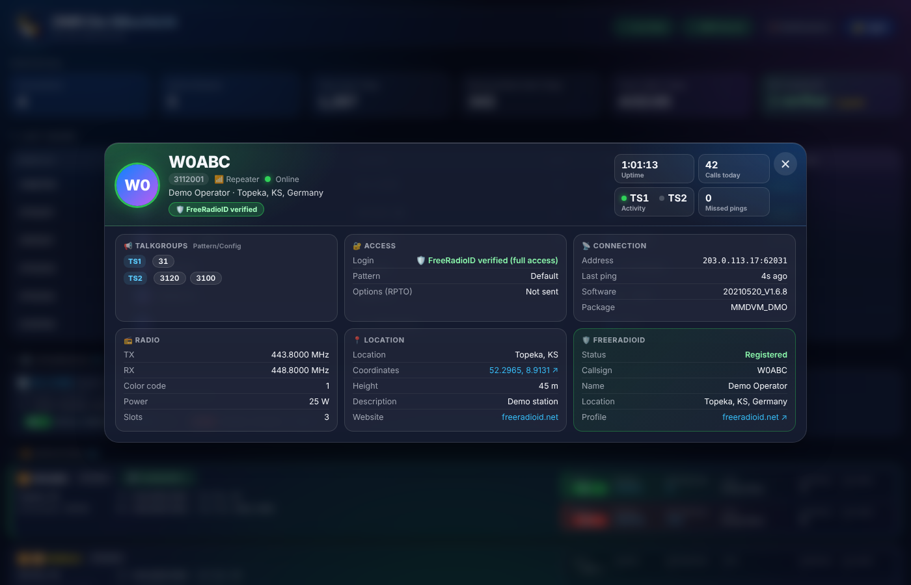

# 🛡️ FreeRadioID

[← Übersicht](../../readme.md) · [Installation](installation.md) · [Dashboard](dashboard.md) · [Adminbereich](adminbereich.md) · [Konfiguration](konfiguration.md) · **FreeRadioID** · [Betrieb & Fehlersuche](betrieb.md)

---

[FreeRadioID.net](https://freeradioid.net) von Andi, DO5ALF, gibt jeder DMR-ID ein persönliches Passwort, ein Profil und einen Avatar. Dieser Server nutzt alle drei. **Der Secure Login ist ab Werk eingeschaltet.**

## Secure Login

Jedes Gerät beantwortet bei der Anmeldung eine Zufallszahl des Servers mit `sha256(Zufallszahl + Passwort)`. Mit eingeschaltetem FreeRadioID-Login:

| Das Gerät benutzt … | Ergebnis | Darf senden auf |
|---|---|---|
| sein **persönliches FreeRadioID-Passwort** | 🛡️ **FreeRadioID ✓**, volle Rechte | alle freigegebenen Talkgroups |
| das **Standard-Passwort** des Servers (z. B. `passw0rd`) | 👤 **Gast** | nur die Gast-Talkgroups (Vorgabe 26501, 26502, 26503) |
| etwas anderes | abgelehnt | – |

Empfangen können auch Gäste alles, was ihre Talkgroups erlauben. Beschränkt ist nur das Senden.

Das Passwort selbst kommt nie bei deinem Server an. HBlink4 fragt FreeRadioID.net nur nach dem erwarteten Hash für diese ID und Zufallszahl und prüft die Antwort mit einem Token. Die Anfrage läuft im Hintergrund, eine langsame API bremst also keinen Funkverkehr.

**Wenn FreeRadioID.net nicht erreichbar ist:** Gäste kommen weiter rein. Registrierte Stationen kommen erst wieder mit ihrem FreeRadioID-Passwort rein, wenn die API zurück ist. Bis dahin können sie das Standard-Passwort nehmen.

### Einstellen

Im Adminbereich unter **Settings → 🛰️ DMR server → 🛡️ FreeRadioID login**:

| Einstellung | Bedeutung |
|---|---|
| FreeRadioID secure login | an/aus; wirkt sofort für neue Anmeldungen |
| Guest talkgroups | Talkgroups für Gäste; `all` = keine Beschränkung, `none` = Gäste dürfen nicht senden |
| API timeout | Wartezeit auf FreeRadioID.net in Sekunden |

Für eigene Repeater mit privatem Passwort schaltest du FreeRadioID pro Pattern ab: `"freeradioid": false` in dessen `config`, siehe [Patterns](konfiguration.md#patterns-eigene-regeln-pro-repeater).

### Umstieg in zwei Schritten (wie im Betatest)

1. FreeRadioID einschalten und das bekannte Standard-Passwort lassen. Alle kommen weiter rein: Registrierte mit vollen Rechten, alle anderen als Gast.
2. Später das Standard-Passwort auf ein privates ändern. Dann kommen nur noch registrierte FreeRadioID-Nutzer rein, plus wer das neue Passwort kennt.

### Was Funkamateure an ihrem Gerät eintragen

All das zeigt das Dashboard im Tab **🛠️ Configuration**, mit Kopier-Knöpfen und fertigen Zeilen für Pi-Star/WPSD und MMDVMHost (siehe [Dashboard](dashboard.md#️-configuration--so-verbindest-du-dich)).

| Feld (Pi-Star / WPSD / MMDVMHost) | Wert |
|---|---|
| Server / Address | dein Servername, z. B. `dmr.die-n8schicht.de` |
| Port | 62031 (bzw. der eingestellte DMR-Port) |
| Password | das persönliche Passwort von FreeRadioID.net, sonst das Gast-Passwort |
| ID | die eigene DMR-ID (Hotspots auch mit zwei Ziffern Suffix, z. B. `262123401`) |

## Im Dashboard

| | |
|---|---|
|  | 🛡️ **FreeRadioID ✓**: grüner Rand, verifiziert |
|  | 👤 **Guest**: gelber Rand, sendet nur auf Gast-Talkgroups |

Die Statistik-Kachel **🛡️ FreeRadioID** zählt verifizierte Stationen und Gäste. In Last Heard steht 🛡️ an Quellen mit FreeRadioID-Login und **FRID** an Sprechern, deren ID bei FreeRadioID.net registriert ist.

## Avatare und Profile

- **Avatare** kommen von `freeradioid.net/api/idimg-<ID>.png`, also dem Bild auf der FreeRadioID-Profilseite, und **nur für registrierte IDs**.
  - Das Dashboard lädt sie zusammen mit der ID-Liste, verkleinert sie auf 192 px (WebP) und speichert sie in SQLite. Das geht schnell und schont FreeRadioID.net.
  - Neu geprüft wird wöchentlich, IDs ohne Bild täglich.
- **Kein eigenes Bild:** Dann zeigt das Dashboard die Initialen des Rufzeichens.
- **Profile** (Name, Ort, Land, Profil-Link) stehen in der Detailansicht und werden eine Stunde zwischengespeichert.
- **Abschalten:** Beides geht im Adminbereich unter *Settings → 🛡️ FreeRadioID data*.

## ID-Listen: Rufzeichen von FreeRadioID.net

Das Dashboard übersetzt DMR-IDs in Rufzeichen. **Vorgabe ist die Gesamtliste von FreeRadioID.net** (`freeradioid.net/api/subscriber_ids.csv`): alle IDs von radioid.net plus die FreeRadioID-eigenen IDs, für **alle Länder**. Aktualisiert wird täglich um 03:17.

Im Adminbereich unter *Settings → 📘 Callsign database* lässt sich die Quelle auf radioid.net umstellen, auf Länder filtern (z. B. `Germany, Austria, Switzerland`) und mit **⟳ Refresh now** sofort neu laden.

Bestehende Installationen werden beim Update automatisch auf FreeRadioID.net umgestellt, **wenn** dort noch die alte Vorgabe (radioid.net, USA/Kanada) aus der Config-Datei stand. Hat ein Admin die Quelle bewusst geändert, bleibt sie.

Technische Details (API, Hash-Verfahren, Events) auf Englisch: [docs/freeradioid.md](../freeradioid.md).

---

Weiter: [🩺 Betrieb & Fehlersuche](betrieb.md)
