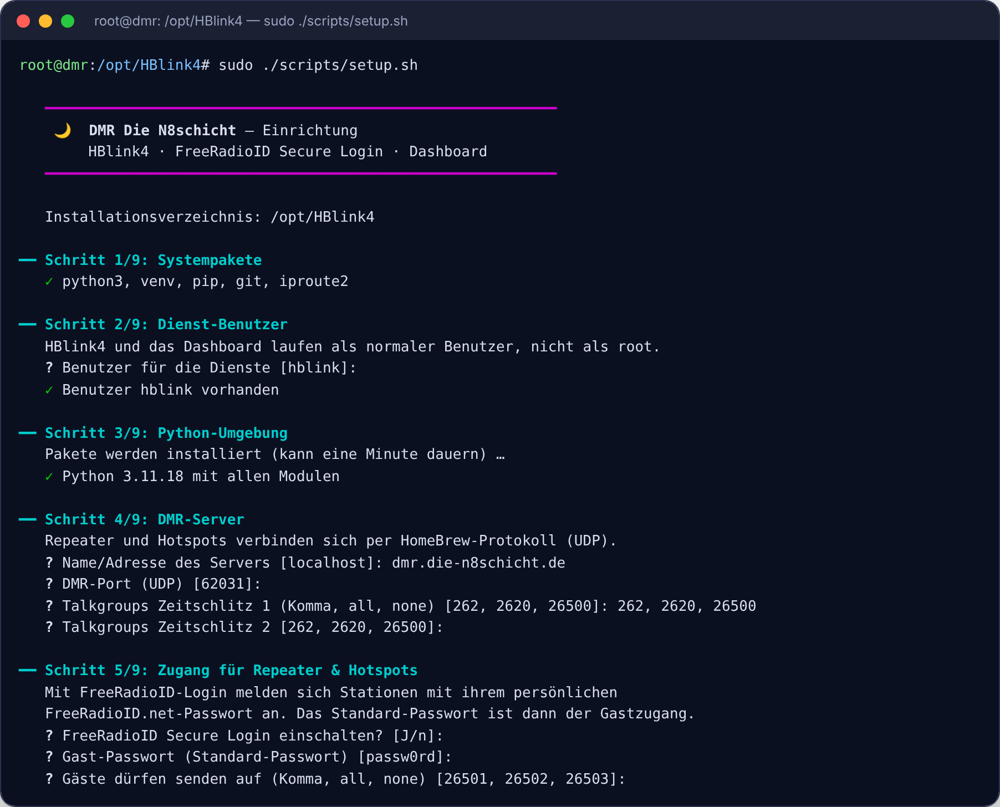
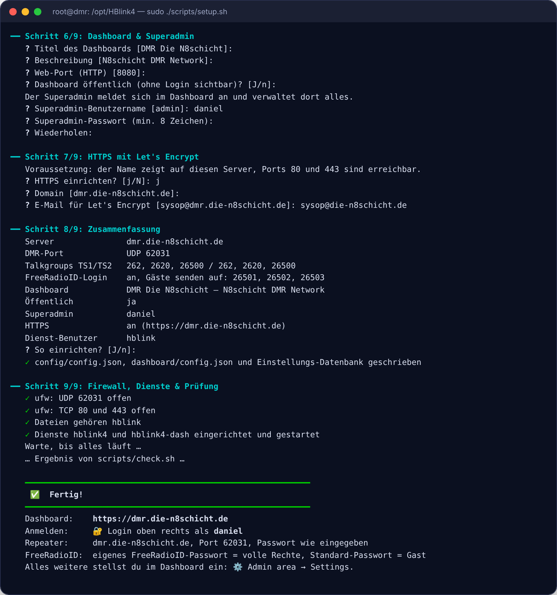

# 📦 Installation

[← Übersicht](../../readme.md) · **Installation** · [Dashboard](dashboard.md) · [Adminbereich](adminbereich.md) · [Anleitungen](anleitungen.md) · [Konfiguration](konfiguration.md) · [FreeRadioID](freeradioid.md) · [Betrieb & Fehlersuche](betrieb.md)

---

## Voraussetzungen

| | |
|---|---|
| **System** | Debian 12/13 oder Ubuntu 22.04+ (auch Raspberry Pi OS), 1 CPU, 512 MB RAM reichen |
| **Python** | 3.9 oder neuer; das Skript installiert alles Nötige |
| **Netzwerk** | **UDP 62031** für Repeater und Hotspots, **TCP 8080** für das Dashboard; mit HTTPS stattdessen **TCP 80 und 443** |
| **HTTPS (optional)** | ein DNS-Name, der auf den Server zeigt, z. B. `dmr.die-n8schicht.de` |
| **Rechte** | root bzw. `sudo` für die Installation; HBlink4 und das Dashboard laufen danach als normaler Benutzer |

> ⚠️ **Nur ein DMR-Server pro Port.** Läuft auf dem Server schon ein anderer DMR-Server, zum Beispiel ADN/FreeDMR mit seinem Proxy auf 62031, braucht HBlink4 einen anderen Port.

## Geführte Installation

```bash
git clone https://github.com/dhartmann1979/HBlink4-FreeRadioID /opt/HBlink4
sudo /opt/HBlink4/scripts/setup.sh
```

Das Skript arbeitet neun Schritte ab. Jede Frage zeigt eine Vorgabe in `[Klammern]`; mit **Enter** übernimmst du sie.

<p align="center"></p>

| Schritt | Was passiert | Worauf achten |
|---|---|---|
| 1 Systempakete | installiert `python3`, `python3-venv`, `pip`, `git`, `iproute2` | – |
| 2 Dienst-Benutzer | Benutzer, unter dem die Dienste laufen; legt ihn bei Bedarf an (Vorgabe `hblink` bzw. der Besitzer des Verzeichnisses) | Auf einem Server mit ADN/FreeDMR kannst du dessen Benutzer nehmen, z. B. `adn`. |
| 3 Python-Umgebung | legt `venv/` an und installiert die Module | dauert etwa eine Minute |
| 4 DMR-Server | Name des Servers, DMR-Port, Talkgroups für Zeitschlitz 1 und 2 | `all` = alle Talkgroups, `none` = keine |
| 5 Zugang | FreeRadioID Secure Login an/aus, Standard-Passwort, Gast-Talkgroups | Mit FreeRadioID ist das Standard-Passwort der **Gastzugang**. |
| 6 Dashboard | Titel, Beschreibung, Web-Port, öffentlich ja/nein, **Superadmin** mit Passwort | Das Passwort wird nur als Hash gespeichert. |
| 7 HTTPS | Domain und E-Mail für Let's Encrypt; installiert certbot | nur, wenn die Domain schon auf den Server zeigt |
| 8 Zusammenfassung | zeigt alles an und fragt nach der Bestätigung | Erst danach wird etwas geändert. Alte Configs werden als `*.bak` gesichert. |
| 9 Abschluss | Firewall (ufw), Rechte, systemd-Dienste, Start, `check.sh` | – |

<p align="center"></p>

Danach öffnest du das Dashboard (`http://dein-server:8080` bzw. `https://deine-domain`) und meldest dich oben rechts mit **🔐 Login** als Superadmin an. Alles Weitere stellst du im [Adminbereich](adminbereich.md) ein.

### Das Skript erneut ausführen

`setup.sh` kann jederzeit erneut laufen. Auf einer bestehenden Installation zeigt es die **aktuellen** Werte als Vorgabe, auch die, die inzwischen im Adminbereich geändert wurden. Beim Superadmin-Passwort lässt Enter das bisherige Passwort stehen.

Optionen per Umgebungsvariable:

| Variable | Wirkung |
|---|---|
| `SKIP_APT=1` | keine Systempakete installieren |
| `SKIP_SERVICES=1` | keine systemd-Dienste einrichten (dann `run_all.sh` zum Testen) |
| `SKIP_FIREWALL=1` | Firewall nicht anfassen |

## Was das Skript anlegt

| Datei / Ort | Inhalt |
|---|---|
| `config/config.json` | DMR-Server: nur das Nötigste für den ersten Start, siehe [Konfiguration](konfiguration.md) |
| `dashboard/config.json` | Dashboard: Superadmin, Web-Adresse, Verbindung zu HBlink4 |
| `dashboard/data/dashboard.db` | **SQLite: alle Einstellungen**, Benutzer, Sitzungen, Protokoll, Avatare |
| `/etc/systemd/system/hblink4.service`, `hblink4-dash.service` | die beiden Dienste, Start beim Booten |
| `venv/` | Python-Umgebung |

## HTTPS mit Let's Encrypt

Am einfachsten richtest du HTTPS gleich in Schritt 7 des Skripts ein. Später geht es im Adminbereich unter **Settings → 🔒 HTTPS & web**, danach startest du das Dashboard neu (Knopf im Adminbereich).

- **Port 80** beantwortet die Let's-Encrypt-Prüfung und leitet auf HTTPS um.
- **Port 8080** leitet ebenfalls um.
- **Erneuerung:** Das Zertifikat wird automatisch erneuert und ohne Neustart geladen.
- **Ohne root:** certbot läuft als Dienst-Benutzer und speichert alles in `dashboard/data/letsencrypt/`.
- **Wenn es nicht klappt:** Das Dashboard bleibt per HTTP erreichbar, und der Grund steht im Log (`journalctl -u hblink4-dash`).

## Aktualisieren

```bash
cd /opt/HBlink4
sudo -u hblink git pull                       # Dienst-Benutzer einsetzen
sudo -u hblink ./venv/bin/pip install -r requirements.txt -r requirements-dashboard.txt
sudo systemctl restart hblink4 hblink4-dash
sudo ./scripts/check.sh
```

`git pull` ändert weder die Config-Dateien noch die Datenbank. Neue Einstellungen erscheinen nach dem Neustart im Adminbereich mit ihrer Vorgabe.

## Ohne das Skript (Handarbeit)

Wer jeden Schritt selbst machen will, geht so vor:

```bash
cd /opt/HBlink4
python3 -m venv venv
./venv/bin/pip install -r requirements.txt -r requirements-dashboard.txt
cp config/config_sample.json config/config.json
cp dashboard/config_sample.json dashboard/config.json
./venv/bin/python -m dashboard.auth hash-password      # Hash für den Superadmin
nano dashboard/config.json                              # auth.superadmin eintragen
sudo chown -R hblink:hblink /opt/HBlink4
sudo ./scripts/install_services.sh
```

Was in den beiden Dateien steht, erklärt [Konfiguration](konfiguration.md).

---

Weiter: [🎙️ Dashboard](dashboard.md)
