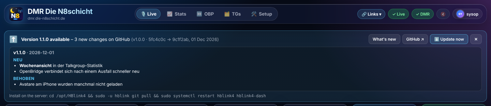

# Versionen und Updates

Seit dem **21.11.2026** hat HBlink4-FreeRadioID eine Versionsnummer. Die erste ist **1.0.0**.

## Welche Version läuft?

- unten in der **Fußzeile** jeder Seite: `HBlink4-FreeRadioID v1.0.0 (Commit) · Datum`
- im Adminbereich unter **🖥️ System → ⬆️ Version**, dort auch die HBlink4-Version, auf der sie aufbaut
- auf dem Server: `cat /opt/HBlink4/VERSION`

## Was die Nummer bedeutet

Die Nummer hat drei Teile, `MAJOR.MINOR.PATCH` ([Semantic Versioning](https://semver.org/lang/de/)):

| Teil | steigt, wenn … | Beispiel |
|---|---|---|
| **PATCH** | ein Fehler behoben wird, ohne dass sich die Bedienung ändert | 1.0.0 → 1.0.1 |
| **MINOR** | etwas Neues dazukommt; bestehende Einstellungen laufen weiter | 1.0.1 → 1.1.0 |
| **MAJOR** | sich etwas so ändert, dass Einstellungen angepasst werden müssen; steht dann ausdrücklich im Änderungstext | 1.4.2 → 2.0.0 |

## Wo die Änderungen beschrieben sind

- **[CHANGELOG.md](../../CHANGELOG.md)** im Repository: jede Version mit Datum und ausführlicher Beschreibung, die neueste oben.
- **GitHub-Releases** ([Releases](https://github.com/dhartmann1979/HBlink4-FreeRadioID/releases)): Zu jeder Version erstellt GitHub automatisch ein Release mit demselben Text.
- **Im Dashboard:** Der Update-Hinweis für Admins zeigt die neue Versionsnummer und die Änderungstexte aller Versionen seit der installierten ([Adminbereich → Update-Hinweis](adminbereich.md#️-update-hinweis)).

<p align="center"></p>

## So entsteht eine neue Version

Für alle, die am Repository arbeiten:

1. Änderungen machen, testen (`python3 -m pytest -q`), Doku und Screenshots anpassen.
2. In **CHANGELOG.md** oben einen Abschnitt anlegen – ausführlich, so dass ein Sysop versteht, was sich für ihn ändert:

   ```markdown
   ## [1.1.0] – 2026-12-01

   ### Neu
   - …
   ### Behoben
   - …
   ### Wichtig beim Update
   - …
   ```

3. Version setzen, committen und Tag anlegen:

   ```bash
   python3 scripts/release.py 1.1.0
   git push && git push origin v1.1.0
   ```

   Das Skript prüft vorher, ob der Abschnitt da ist, ob er der neueste ist und ob die Nummer größer ist als die alte.
4. Nach dem Push des Tags erstellt die GitHub-Action **Release** (`.github/workflows/release.yml`) das Release mit dem Text aus CHANGELOG.md.

`python3 scripts/release.py --check` prüft, ob `VERSION` und der neueste Eintrag in CHANGELOG.md zusammenpassen.
