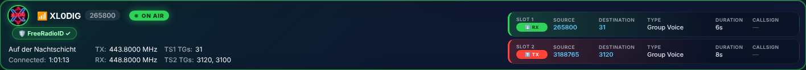
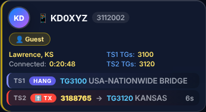
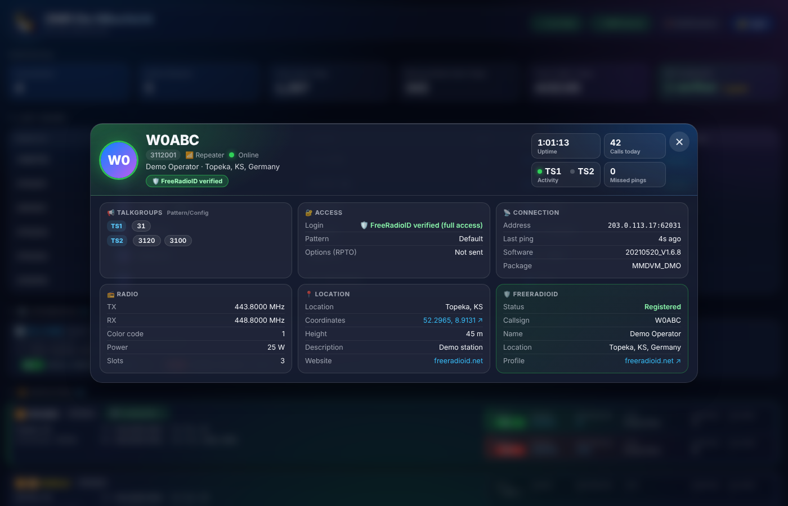

# FreeRadioID secure login

HBlink4 can verify repeater and hotspot logins against
[FreeRadioID.net](https://freeradioid.net/betatest.html). This is a port of the
FreeRadioID "FDMR-Secure-Server" beta (DO5ALF), originally written as a
replacement `hblink.py` / `hotspot_proxy_v2.py` for FreeDMR/ADN servers.

HBlink4 needs no proxy: it serves every repeater on one port and sees each
client's real IP, so only the login check had to be ported.

## How a login is decided

Every HomeBrew login answers the server's random salt with
`sha256(salt + password)`. With FreeRadioID enabled:

| The device sent the hash of…              | Result                                               |
|-------------------------------------------|------------------------------------------------------|
| its personal FreeRadioID password         | **freeradioid** – full access                        |
| the pattern's local `passphrase`          | **guest** – TX only to `guest_talkgroups`            |
| anything else                             | rejected (MSTNAK)                                    |

For a FreeRadioID login, HBlink4 asks the API for the hash it *expects* for that
radio ID and salt. The password itself never reaches your server.

```
POST https://freeradioid.net/api/adn-login.php
  Cookie: TOKEN=md5("*<id>#<salt>/FRID*"); KEY=<salt as 8 hex chars>
  Form:   action=GPWD&ID=<id>&SALT=<salt>&CIP=<client ip>
→ {"RESULT": true, "RT": md5("RESULT+<id>-<TOKEN>"), "RH": "<expected hash>"}
```

The answer is accepted only if `RT` matches. The request runs in a worker
thread, so a slow API never stalls traffic. If the API is down, guests can still
log in. Registered users cannot log in until the API is back, unless they use
the local passphrase.

Guests can still receive everything their talkgroup settings allow. Only what
they can *transmit* is limited.

## Configuration

```json
"freeradioid": {
    "enabled": true,
    "api_url": "https://freeradioid.net/api/adn-login.php",
    "timeout": 3.0,
    "guest_talkgroups": [26501, 26502, 26503]
}
```

* `guest_talkgroups`: `null` means guests are not restricted, and `[]` means
  guests cannot transmit at all.
* FreeRadioID applies to every pattern, `default` included. To keep a pattern
  on the plain passphrase check (for example your own repeaters with a private
  passphrase), set `"freeradioid": false` in that pattern's `config`.

### Migration path (same as the beta)

1. Enable it with the public default passphrase. Existing users carry on as
   guests, and registered users get full access.
2. Later, change the default passphrase to a private one. Then only registered
   FreeRadioID users, plus whoever knows the new passphrase, can connect.

## Dashboard

The dashboard shows how each connection logged in:

* **🛡️ FreeRadioID ✓** badge with a green edge: verified by FreeRadioID.net
* **👤 Guest** badge with a yellow edge: default passphrase, TX limited to the guest talkgroups
* No badge: plain server passphrase (FreeRadioID off for that pattern)




A **FreeRadioID** statistics tile counts verified and guest logins. The detail
dialog has a **Login** row, and Last Heard marks traffic from verified sources
with 🛡️.

The data comes from the `auth_method` field (`local`, `freeradioid` or `guest`)
in the `repeater_connected` events and in `/api/repeaters` and
`/api/repeater/{id}` (`access_control.auth_method`).

## FreeRadioID data in the dashboard

The dashboard also uses the [FreeRadioID API](https://freeradioid.net/api-index.html):

* **Avatars** (`api/idimg-<id>.png`, the per-ID image of the FreeRadioID profile pages), only for registered IDs: fetched with the ID list, scaled from 500×500 PNG (~750 KB) to 192 px WebP and stored in SQLite; served by `/api/avatar/{id}`. FreeRadioID's grey placeholder for IDs without an image means initials. Placeholders are re-checked daily, images weekly.
* **Profiles** (`api/dmr/user/?id=<id>`, cached for an hour) in the detail view, also at `GET /api/freeradioid/{id}`
* **Registered IDs** (`api/local_subscriber_ids.json`), loaded daily without a country filter and tagged `FRID` in Last Heard
* **Combined list** (`api/subscriber_ids.csv`, header-less) usable as `user_database.source_url`



These options are switched in the admin area (Settings → FreeRadioID / Callsign database); on the first start they are taken from `dashboard/config.json`.

