<p align="center">
  
</p>

<p align="center">
  <b>HBlink4 DMR-Server · FreeRadioID.net Secure Login · Dashboard mit Adminbereich</b><br>
  Der Server hinter <a href="https://dmr.die-n8schicht.de">dmr.die-n8schicht.de</a> – zum Nachbauen für den eigenen Verbund.
</p>

<p align="center">
  <a href="#schnellstart">Schnellstart</a> ·
  <a href="docs/de/installation.md">Installation</a> ·
  <a href="docs/de/dashboard.md">Dashboard</a> ·
  <a href="docs/de/adminbereich.md">Adminbereich</a> ·
  <a href="docs/de/konfiguration.md">Konfiguration</a> ·
  <a href="docs/de/freeradioid.md">FreeRadioID</a> ·
  <a href="docs/de/betrieb.md">Betrieb &amp; Fehlersuche</a>
</p>

---

## Was ist das?

Ein DMR-Server für Repeater und Hotspots (HomeBrew-Protokoll, z. B. MMDVM, Pi-Star, WPSD, DMRGateway) auf Basis von [HBlink4](https://github.com/n0mjs710/HBlink4) von N0MJS, erweitert für **DMR Die N8schicht**:

| | |
|---|---|
| 🛡️ **FreeRadioID Secure Login** | Stationen melden sich mit ihrem persönlichen Passwort von [FreeRadioID.net](https://freeradioid.net) an und haben volle Rechte. Wer das allgemeine Passwort benutzt, ist **Gast** und darf nur auf die Gast-Talkgroups senden. |
| 🗂️ **Talkgroup-Verzeichnis** | rund 1.400 Talkgroup-Namen aus der [N8schicht-Liste](https://github.com/dhartmann1979/n8schicht/blob/main/talkgroup_ids.json), mit Suche, Aktivität und eigenen Namen; die Namen stehen auch in Last Heard, auf den Karten und in der Statistik |
| 📈 **Talkgroup-Statistik** | Eigener Tab: welche Talkgroups wie viel laufen, Sprechzeit und Gespräche heute, über 24 h, 7 oder 30 Tage, als Diagramm und Tabelle |
| ↔️ **OpenBridge-Tab** | Trunks zu anderen Netzen (z. B. FreeDMR) mit Status, Gegenstelle, Verkehr in beide Richtungen, Top-Talkgroups, letzten Gesprächen und durchsuchbarer Talkgroup-Liste. In der Live-Ansicht nur kompakt, in der Statistik mitgezählt. |
| 🛠️ **Configuration-Tab** | Server, Port, FreeRadioID- und Gast-Passwort, Talkgroups und fertige Einstellungen für Pi-Star/WPSD und MMDVMHost, zum Kopieren |
| 🎙️ **Live-Dashboard** | Wer gerade spricht, steht immer ganz oben (**ON AIR**). Last Heard zeigt Avatare und FreeRadioID-Profile. Die Darstellung ist für Smartphone und Desktop optimiert. |
| ⚙️ **Adminbereich statt Config-Dateien** | Alle Einstellungen von Dashboard **und** DMR-Server liegen in SQLite und werden im Browser geändert. Änderungen am DMR-Server wirken sofort, ohne SSH. |
| 👥 **Benutzer & Rechte** | Superadmin, Admins und Benutzer. **IP-Adressen sehen nur Admins.** Dazu Sitzungen und ein Protokoll aller Änderungen. |
| 📘 **FreeRadioID-ID-Listen** | Rufzeichen kommen standardmäßig aus der Liste von FreeRadioID.net (radioid.net plus FreeRadioID-IDs). |
| 🔒 **HTTPS** | Let's-Encrypt-Zertifikat, automatisch geholt und erneuert |
| 🧭 **Geführte Installation** | `scripts/setup.sh` fragt alles ab, richtet die Dienste ein und prüft am Ende das Ergebnis. |

<p align="center">
  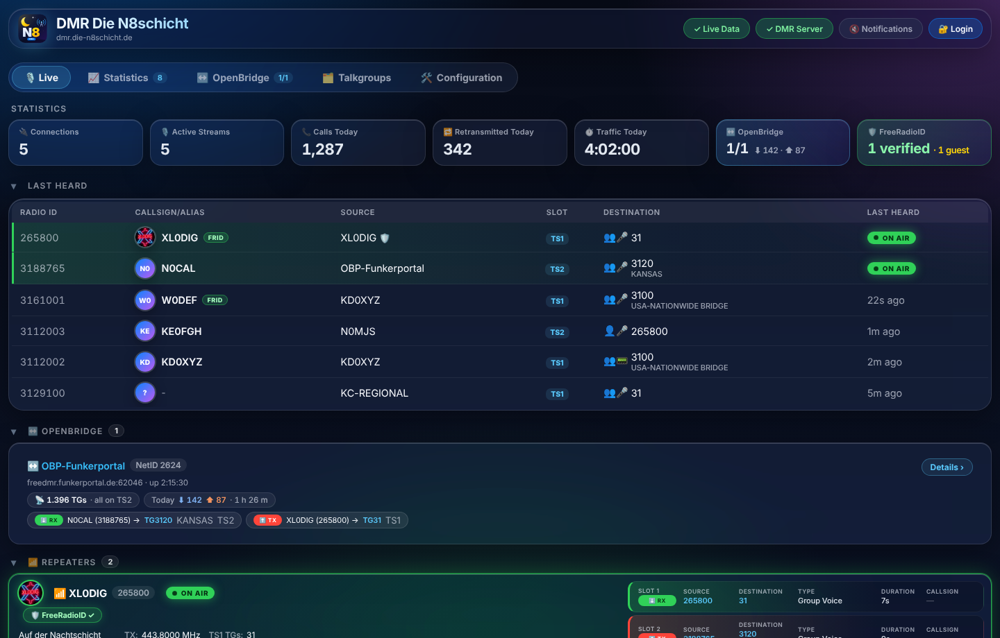
  &nbsp;
  
</p>

## Schnellstart

Auf einem Debian- oder Ubuntu-Server, als root bzw. mit `sudo`:

```bash
git clone https://github.com/dhartmann1979/HBlink4-FreeRadioID /opt/HBlink4
sudo /opt/HBlink4/scripts/setup.sh
```

Das Installationsskript führt durch alle Einstellungen. Jede Frage hat eine Vorgabe, die du mit Enter übernimmst. Danach öffnest du das Dashboard, meldest dich oben rechts an und stellst alles Weitere im **Adminbereich** ein.

<p align="center">
  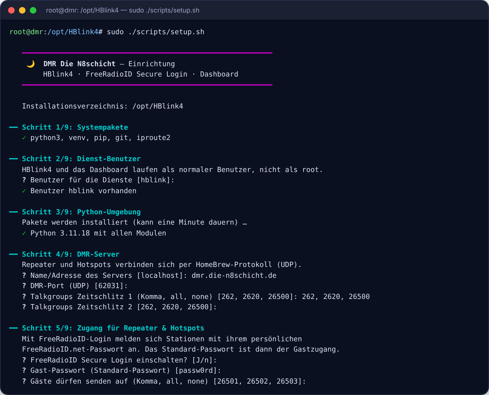
  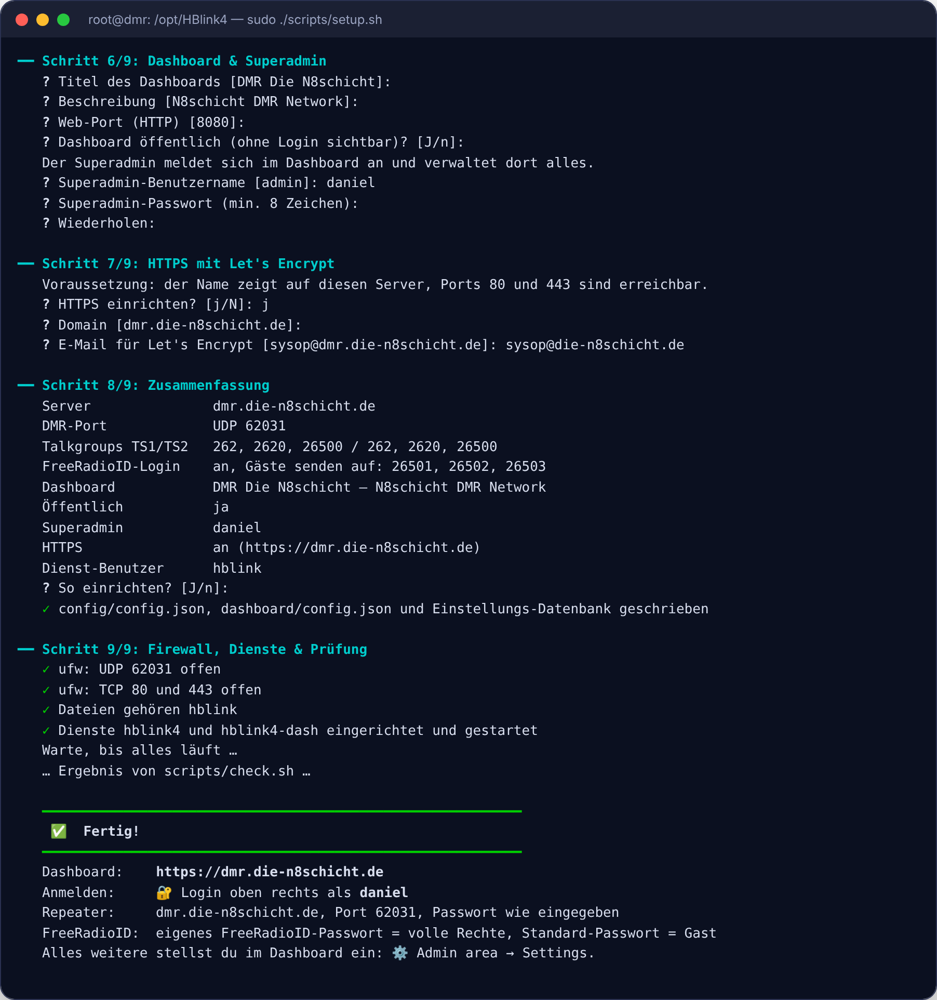
</p>

➡️ Ausführlich: **[Installation](docs/de/installation.md)**

## So sieht es aus

<table>
<tr>
<td width="50%">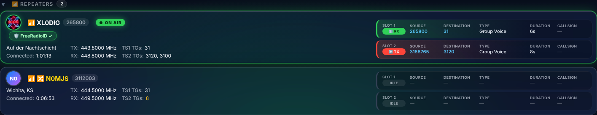<br><b>ON AIR</b>: Die Station, die gerade spricht, steht oben und leuchtet grün.</td>
<td width="50%">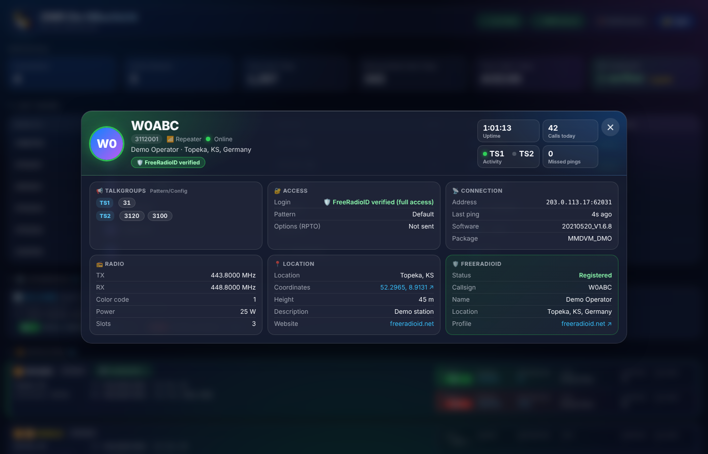<br><b>Detailansicht</b> mit Avatar, FreeRadioID-Profil, Talkgroups und Funkdaten.</td>
</tr>
<tr>
<td>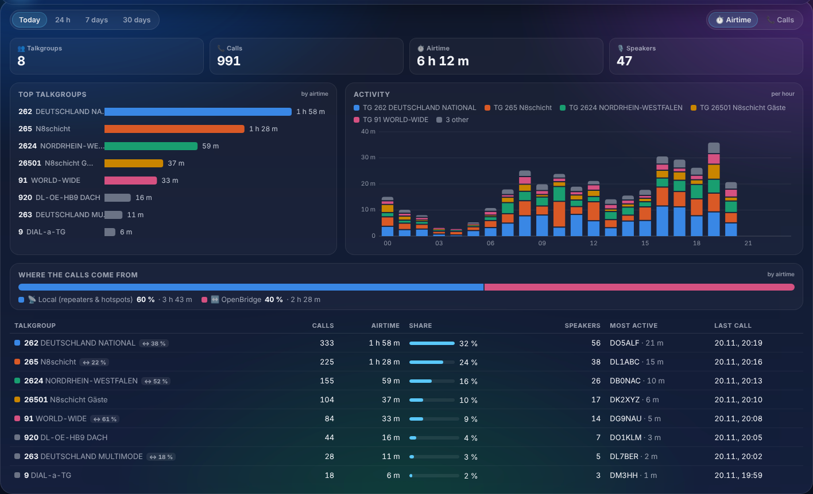<br><b>Tab 📈 Statistics</b>: Top-Talkgroups, Verlauf pro Stunde oder Tag, Tabelle mit aktivster Station.</td>
<td>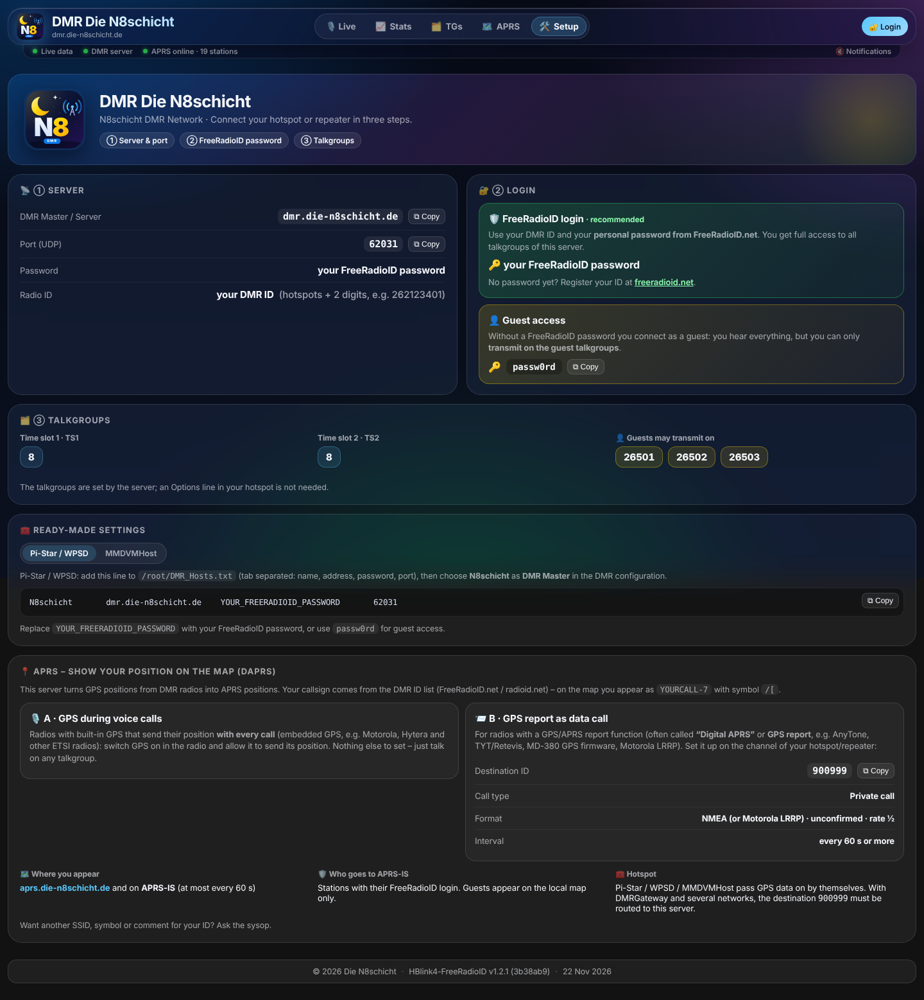<br><b>Tab 🛠️ Configuration</b>: alles zum Verbinden, mit N8schicht-Logo und Kopier-Knöpfen.</td>
</tr>
<tr>
<td>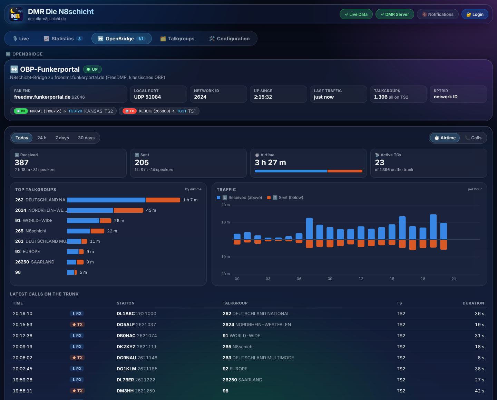<br><b>Tab ↔️ OpenBridge</b>: Trunk-Status, Verkehr empfangen/gesendet, Top-Talkgroups und alle Talkgroups des Trunks.</td>
<td>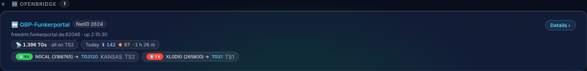<br><b>Kompakt in der Live-Ansicht</b>: Anzahl der Talkgroups, Gespräche heute, laufende Gespräche.</td>
</tr>
<tr>
<td>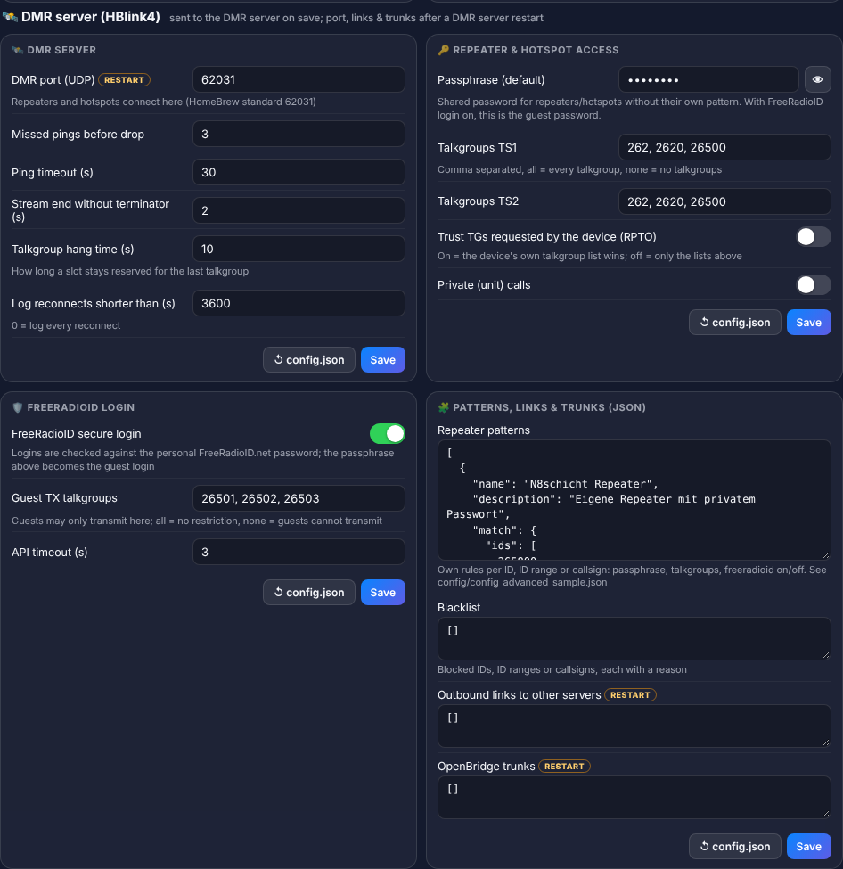<br><b>DMR-Server im Browser</b>: Passwort, Talkgroups, FreeRadioID, Patterns.</td>
<td>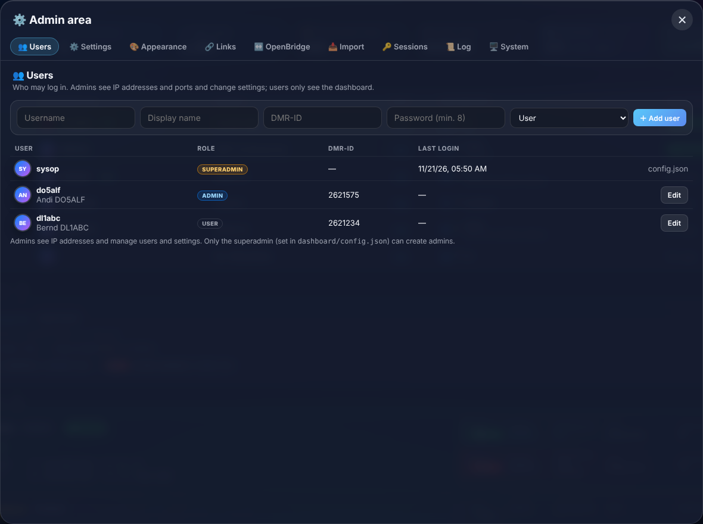<br><b>Benutzerverwaltung</b> mit Rollen. IP-Adressen sehen nur Admins.</td>
</tr>
</table>

## Dokumentation

| Anleitung | Inhalt |
|---|---|
| 📦 [Installation](docs/de/installation.md) | Voraussetzungen, geführte Installation, HTTPS, Firewall, Aktualisieren |
| 🎙️ [Dashboard](docs/de/dashboard.md) | Tabs Live/Statistics/OpenBridge/Talkgroups/Configuration, ON AIR, Talkgroup-Statistik, Last Heard, Karten, Detailansicht, Login-Arten |
| ⚙️ [Adminbereich](docs/de/adminbereich.md) | Anmelden, Rollen, Benutzer, alle Einstellungen, Sitzungen, Protokoll, System |
| 🧾 [Konfiguration](docs/de/konfiguration.md) | Was in den Dateien steht und was in SQLite, alle Einstellungen im Überblick, Patterns |
| 🛡️ [FreeRadioID](docs/de/freeradioid.md) | Secure Login, Gastzugang, Avatare, Profile, ID-Listen |
| 🩺 [Betrieb & Fehlersuche](docs/de/betrieb.md) | Dienste, `check.sh`, typische Fehlermeldungen, Sicherung |

Englisch / technisch: [FreeRadioID login (EN)](docs/freeradioid.md) · [Dashboard (EN)](dashboard/README.md) · [systemd (EN)](SYSTEMD.md) · [Original-README von HBlink4](docs/upstream-readme.md) · [weitere technische Doku des Originals](docs/)

## Aktualisieren

```bash
cd /opt/HBlink4
sudo -u hblink git pull                 # Dienst-Benutzer statt hblink, falls anders gewählt
sudo ./scripts/setup.sh                 # optional: übernimmt die aktuellen Werte als Vorgabe
sudo systemctl restart hblink4 hblink4-dash
```

## Danksagung & Lizenz

- **HBlink4** von Cort Buffington, N0MJS – [n0mjs710/HBlink4](https://github.com/n0mjs710/HBlink4). Ohne HBlink4 gäbe es diesen Fork nicht.
- **FreeRadioID.net** von Andi, DO5ALF: Secure Login, ID-Listen und Avatare. Die Login-Logik ist eine Portierung seines [FDMR-Secure-Server-Betatests](https://freeradioid.net/betatest.html).
- Anpassungen, Dashboard-Erweiterungen und Logo: **DMR Die N8schicht**.

Lizenz wie das Original: GNU GPLv3, Copyright © 2016–2025 Cortney T. Buffington, N0MJS (siehe [Original-README](docs/upstream-readme.md#license)). Support für den Fork gibt es über die Issues dieses Repositorys; Fragen zum Original-HBlink4 bitte nicht an N0MJS.

<p align="center">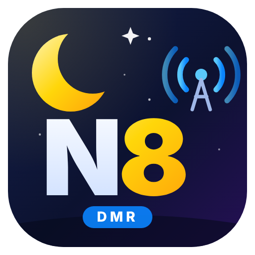</p>
