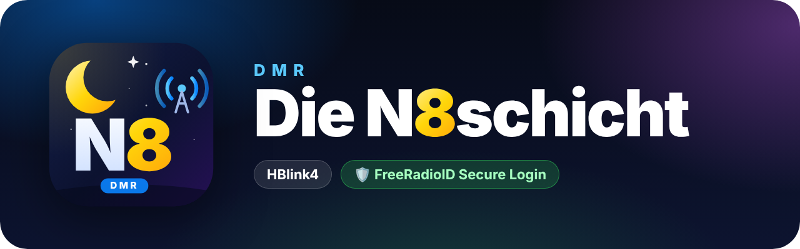
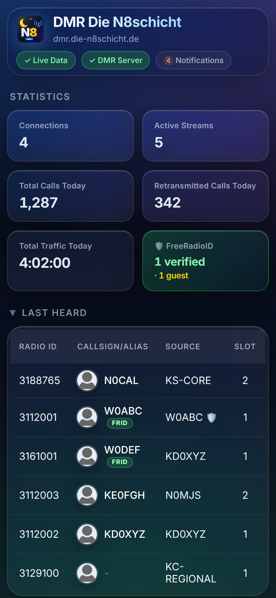

<p align="center">
  
</p>

# HBlink4 · FreeRadioID-Edition von DMR Die N8schicht

Dieser Fork von [n0mjs710/HBlink4](https://github.com/n0mjs710/HBlink4) läuft auf **dmr.die-n8schicht.de**. Er ergänzt HBlink4 um zwei Dinge:

- **FreeRadioID Secure Login**: Repeater und Hotspots können sich mit dem persönlichen Passwort von [FreeRadioID.net](https://freeradioid.net/betatest.html) anmelden. Wer das öffentliche Standard-Passwort benutzt, kommt als **Gast** rein und darf nur auf die Gast-Talkgroups senden.
- **Überarbeitetes Dashboard** im Glass-Look, für Smartphone und Desktop. Jede Verbindung zeigt ein Badge mit ihrer Login-Art. Logo und Favicon lassen sich frei einstellen.
- **FreeRadioID-Daten im Dashboard**: Avatare und Profile von FreeRadioID.net, dazu die DMR-ID-Listen von FreeRadioID. Darin stehen auch Nicht-Amateurfunk-IDs, zum Beispiel 100001. Die Detailansicht jeder Station ist neu gestaltet.

Alles andere entspricht dem Original. Die englische Original-Anleitung folgt weiter unten.

<p align="center">
  
  &nbsp;
  
</p>

## Detailansicht einer Station

Ein Klick auf das Rufzeichen öffnet die Detailansicht:

- **Kopfbereich**: Avatar von FreeRadioID, Rufzeichen, ID, Typ, Online-Status, Name und Ort aus dem FreeRadioID-Profil sowie die Login-Art
- **Kennzahlen**: Uptime, Anrufe heute, Aktivität auf TS1 und TS2, verpasste Pings
- **Kacheln**: Talkgroups als Chips, Zugang, Verbindung, Funkdaten, Standort mit Link zu OpenStreetMap und das FreeRadioID-Profil

<p align="center">
  
  &nbsp;
  
</p>

Mit `Esc`, mit dem ✕ oder mit einem Klick daneben schließt du die Ansicht.

## FreeRadioID: Avatare, Profile und DMR-ID-Listen

Das Dashboard nutzt die [FreeRadioID-API](https://freeradioid.net/api-index.html):

| Quelle | Wofür |
|---|---|
| `avatar-<ID>.png` | Avatar in der Detailansicht und in **Last Heard**. Kann ein Bild nicht geladen werden, erscheinen die Initialen. |
| `api/dmr/user/?id=<ID>` | Profil (Name, Ort, Land, registriert) in der Detailansicht. Wird eine Stunde zwischengespeichert. |
| `api/local_subscriber_ids.json` | Liste der bei FreeRadioID registrierten IDs (rund 400). Sie wird täglich geladen, ohne Länderfilter. Die IDs bekommen in **Last Heard** den Tag `FRID`, und ihre Rufzeichen werden auch angezeigt, wenn sie in der radioid.net-Liste fehlen. |
| `api/subscriber_ids.csv` | Optional: die Gesamtliste von FreeRadioID (radioid.net plus FreeRadioID) als Hauptquelle statt radioid.net |

Einstellungen in `dashboard/config.json`. Alles ist ohne Eintrag schon aktiv:

```json
"user_database": {
    "source_url": "https://freeradioid.net/api/subscriber_ids.csv",
    "filter": { "countries": ["Germany", "Austria", "Switzerland"] },
    "freeradioid": { "enabled": true }
},
"freeradioid": {
    "avatar_url": "https://freeradioid.net/avatar-{id}.png",
    "profile_lookup": true
}
```

- Mit `source_url` auf die FreeRadioID-CSV wechselst du die Hauptliste. Ohne diese Zeile bleibt radioid.net die Hauptliste.
- `"avatar_url": ""` schaltet die Avatare ab, `"profile_lookup": false` die Profilabfrage.

## Login-Arten im Dashboard

| Anzeige | Bedeutung |
|---|---|
|  | **🛡️ FreeRadioID ✓**: Das Passwort wurde von FreeRadioID.net bestätigt. Das Gerät hat volle Rechte und einen grünen Rand. |
|  | **👤 Guest**: Das Gerät hat sich mit dem Standard-Passwort angemeldet und darf nur auf die `guest_talkgroups` senden (Standard: 26501, 26502, 26503). Empfangen kann es alles. |
| ohne Badge | Login mit dem Server-Passwort eines Patterns, bei dem FreeRadioID ausgeschaltet ist (`"freeradioid": false`). |

Außerdem gibt es:
- eine Statistik-Kachel **FreeRadioID** mit der Zahl der verifizierten Geräte und der Gäste,
- im Detail-Fenster (Klick aufs Rufzeichen) die Zeile **Login**,
- in **Last Heard** ein 🛡️ hinter der Quelle, wenn sie per FreeRadioID angemeldet ist.

## Installation dieses Forks

Die Installation läuft wie im Original (siehe [Installation](#installation) weiter unten). Es ändert sich nur die Adresse beim Klonen:

```bash
cd ~
git clone https://github.com/dhartmann1979/HBlink4-FreeRadioID HBlink4
cd HBlink4
python3 -m venv venv
./venv/bin/pip install -r requirements.txt -r requirements-dashboard.txt
cp config/config_sample.json config/config.json
cp dashboard/config_sample.json dashboard/config.json
```

### FreeRadioID einschalten

Ergänze in `config/config.json` diesen Abschnitt:

```json
"freeradioid": {
    "enabled": true,
    "timeout": 3.0,
    "guest_talkgroups": [26501, 26502, 26503]
}
```

- Das `passphrase` unter `repeater_configurations.default` ist das **Standard-Passwort für Gäste**.
- `guest_talkgroups: null` bedeutet, dass Gäste nicht eingeschränkt sind. Bei `[]` dürfen Gäste gar nicht senden.
- Eigene Repeater mit privatem Passwort nimmst du aus, indem du in ihrem Pattern `"freeradioid": false` setzt.
- Wenn die FreeRadioID-API nicht erreichbar ist, kommen Gäste weiterhin rein. Registrierte Nutzer kommen dann nur mit dem Standard-Passwort rein.

Technische Details und das API-Protokoll stehen in **[docs/freeradioid.md](docs/freeradioid.md)**.

### Eigenes Logo im Dashboard

In `dashboard/config.json`:

```json
"dashboard_title": "DMR Die N8schicht",
"server_name": "dmr.die-n8schicht.de",
"logo": "/static/n8schicht-icon.svg",
"favicon": "/static/n8schicht-icon.svg"
```

Eigene Logos legst du nach `dashboard/static/`. Ohne Eintrag erscheint automatisch das N8schicht-Logo, auch bei einer älteren `config.json`.

Für Rufzeichen aus Deutschland trägst du im Abschnitt `user_database` unter `countries` zusätzlich `"Germany"` ein. Das ist in der [Dashboard-Anleitung](dashboard/README.md#callsign-lookups) beschrieben.

### Starten und aktualisieren

```bash
sudo ./scripts/install_services.sh                       # einmalig: systemd-Dienste anlegen
git pull && sudo systemctl restart hblink4 hblink4-dash  # Update
```

Neue Versionen des Originals übernimmst du so:

```bash
git remote add upstream https://github.com/n0mjs710/HBlink4   # einmalig
git pull upstream main && git push
```

### Logo


Das Logo von **DMR Die N8schicht** liegt als SVG unter `dashboard/static/n8schicht-icon.svg`. Ein PNG in 512 px findest du unter `docs/images/n8schicht-logo.png`, ein PNG in 192 px unter `dashboard/static/n8schicht-icon-192.png`. Der Banner ist `docs/images/n8schicht-banner.png`.

<br clear="right">

---

# HBlink4

HBlink4 is a DMR server using the HomeBrew protocol, by Cort Buffington, N0MJS. It is the server a club or regional network runs for **its own talkgroups**.

HBlink4 assumes repeaters and hotspots use **DMRGateway**, which can connect to several networks at once. Each talkgroup then comes straight from the network that originates it, not through a chain of networks, so there are fewer protocol translations, less latency and less jitter. HBlink4 serves your network's talkgroups and leaves the rest to DMRGateway. It is **not** a transit router for traffic from other networks.

> **Which HBlink?** Despite the number, HBlink4 does not replace HBlink3. They implement two different network models:
> - **HBlink4: your network's own server.** One UDP port serves every repeater and hotspot, and each connection is handled individually with its own talkgroups. Repeaters and hotspots reach other networks directly through DMRGateway.
> - **HBlink3: transit routing between networks.** It works like the Internet: each HBlink3 domain is like an autonomous system, and OpenBridge links domains together the way routers connect at network boundaries. An HBlink3 system is a group of repeaters sharing one administrative policy, which is how many operators want their DMR systems to work. HBlink3 is also the protocol stack to build on if you want to write your own DMR application.
>
> Many networks will want both. KS-DMR runs HBlink4 for DMRGateway-connected hotspots and repeaters, and HBlink3 for the repeaters it owns and links.

There has been some chatter coming my way about what is "official" with respect to HBlink. I can't stop others from claiming they are the "official" source, or using account names that make them look officical. All I can say is that I'm the author, and I'm the copyright holder. What is the status?
 - **HBlink (DEPRECIATED):** Original Python2 based system, interacted with DMRlink for IPSC/HBP translations. Worked on a "system" level and supported internetworking via a "conference bridge" paradigm. Highly configurable for a time before DMRgateway.
 - **HBlink3 (ACTIVE DEVELOPMENT):** Rewrite in Python3, mostly the same code base updated. Dropped direct support for IPSC/HBP translations.
 - **HBlink4 (ACTIVE DEVLOPMENT):** Ground up re-write for modern times. Repeater, not system based. Supports full dynamic TGID subscription and TS/TGID translation based on "Options" configuration send by MMDVMHost or DMRGatway. Includes integrated dashboard application as part of the package.

For those who need Motorola IPSC connectivity, **see my companion project ipsc2hbp to convert from Motorola's proprietary network protocol to MMDVM's**.

## Architecture

HBlink4 focuses on being an efficient **endpoint network server** with the following design principles:

- **Per-repeater routing rules** using TS/TGID tuples for precise call handling
- **Individual repeater management** rather than server-level "system" groupings
- **Direct source connectivity** without multi-hop relay complexity
- **Granular per-repeater control and monitoring**
- **Tightly integrated web dashboard** - Real-time monitoring with WebSocket updates

## Features

- **Native dual-stack IPv4/IPv6 support** - Simultaneous listening on both protocols for maximum compatibility
- Modern Python implementation with type hints
- Improved error handling and logging
- JSON-based configuration
- Enhanced repeater management
- Built on Python's `asyncio` for single-loop UDP I/O with no external framework dependency
- **Tightly integrated web dashboard** - Real-time monitoring with modern look and feel (see [Dashboard Documentation](dashboard/README.md))
- **Stream tracking with immediate DMR terminator detection (~60ms)**
- **Real-time duration counter with 1-second updates**
- **Two-tier stream end detection (immediate terminator + timeout fallback)**
- **Per-repeater DMRD translation** - slot/TGID remap and outbound rf_src override declared via RPTO (see [DMRD Translation](docs/dmrd_translation.md))
- **OpenBridge (OBP) trunks** - stream-multiplexed, HMAC-authenticated server-to-server trunking to/from a core (e.g. HBlink3); many talkgroups over one socket (see [OpenBridge Trunks](docs/openbridge.md))
- **FreeRadioID secure login** - optional verification of repeater/hotspot logins against personal FreeRadioID.net passwords, with guest access on the default passphrase (see [FreeRadioID](docs/freeradioid.md))
- **Unit (private) call routing** - User cache with broadcast fallback, subscriber-pair hang time, cross-slot support, and optional forwarding over outbound server links (implicit reverse-path tree when peers are HBlink4)
- Pattern-based repeater configuration and blacklisting
- Per-slot transmission management

## Installation

Linux, Python 3.9 or newer. Run every step as your normal login account — **not**
as root, and not with `sudo` except where a step says to. HBlink4 runs from the
directory you clone it into and writes its logs and dashboard data there, so it
has to be a directory your own account owns.

### 1. Install the prerequisites

Debian, Ubuntu, or Raspberry Pi OS:

```bash
sudo apt update
sudo apt install -y git python3 python3-venv
```

Fedora, RHEL, or Rocky:

```bash
sudo dnf install -y git python3
```

### 2. Get the code

```bash
cd ~
git clone https://github.com/n0mjs710/HBlink4
cd HBlink4
```

Every remaining step is run from inside this directory.

### 3. Create the virtual environment and install dependencies

```bash
python3 -m venv venv
./venv/bin/pip install -r requirements.txt -r requirements-dashboard.txt
```

### 4. Create your configuration

```bash
cp config/config_sample.json config/config.json
cp dashboard/config_sample.json dashboard/config.json
```

Open `config/config.json` and change `passphrase` from `CHANGE-ME` to a password
of your choosing. That is the only edit needed to get running — every repeater
you connect must be set to the same passphrase.

```bash
nano config/config.json
```

Outside the United States and Canada? The dashboard only shows callsigns for
those two countries until you
[add yours](dashboard/README.md#callsign-lookups).

### 5. Try it out

```bash
./run_all.sh
```

This starts both programs in your terminal. You should see
`✓ HBlink4 listening on 0.0.0.0:62031`. Open **http://localhost:8080** in a
browser to see the dashboard — if you are installing on a remote machine, use
that machine's address instead of `localhost`.

Press **Ctrl+C** to stop.

### 6. Open the firewall

Repeaters reach HBlink4 over **UDP port 62031**, and the dashboard is served on
**TCP port 8080**. If the machine runs a firewall, allow them:

```bash
sudo ufw allow 62031/udp
sudo ufw allow 8080/tcp
```

Use `firewall-cmd` instead of `ufw` on Fedora/RHEL. If HBlink4 is behind a home
router, forward UDP 62031 to this machine as well.

### 7. Run it as a service

So HBlink4 starts automatically at boot and restarts if it stops:

```bash
sudo ./scripts/install_services.sh
```

The script fills in your user, group, and paths, then offers to enable and start
both services. Answer `y` to both. Check them with:

```bash
systemctl status hblink4 hblink4-dash
```

Details and manual instructions are in **[SYSTEMD.md](SYSTEMD.md)**.

### Upgrading

There is no install step to repeat — pull and restart:

```bash
cd ~/HBlink4
git pull
sudo systemctl restart hblink4 hblink4-dash
```

Your `config/config.json` and `dashboard/config.json` are never touched by
`git pull`.

## Configuration

`config/config_sample.json` is a minimal, working starting point. To go further:

- **[Configuration Guide](docs/configuration.md)** — every setting, explained
- **`config/config_advanced_sample.json`** — a reference file showing every
  section HBlink4 understands: blacklists, per-repeater rule patterns, links to
  other servers, and OpenBridge trunks. Copy the pieces you need into your
  `config/config.json`; do not use it as your config wholesale, as its example
  ID ranges and passphrases are invented.
- **[Connecting Repeaters](docs/connecting_to_hblink4.md)** — how to point a
  repeater or hotspot at your new server

## Running without systemd

```bash
./run_all.sh    # both programs in one terminal; activates the venv for you
```

To run them separately, activate the virtual environment first in each terminal
— otherwise `python3` is the system interpreter and will not find the
dependencies:

```bash
source venv/bin/activate
python3 run_hblink.py config/config.json   # the server
python3 run_dashboard.py                   # the dashboard, in another terminal
```

`run_hblink.py` and `run_dashboard.py` are convenience launchers containing no
logic. The modules they point at run just as well on their own, which is what
the systemd units use — no venv activation needed:

```bash
/path/to/HBlink4/venv/bin/python /path/to/HBlink4/hblink4/hblink.py /path/to/HBlink4/config/config.json
/path/to/HBlink4/venv/bin/python /path/to/HBlink4/dashboard/server.py
```

Both read their configuration from disk: the server's config path defaults to `config/config.json`, and the dashboard takes its bind address and port from the `web` section of `dashboard/config.json`. Each accepts the same overrides on the command line for one-off runs.

See [Dashboard Documentation](dashboard/README.md) for dashboard features and configuration.

## Documentation

Comprehensive documentation is available in the `docs/` directory:

- **[Configuration Guide](docs/configuration.md)** - Complete configuration reference with all settings explained
- **[Dashboard README](dashboard/README.md)** - Dashboard features and usage
- **[Systemd Service Installation](SYSTEMD.md)** - Production deployment with automatic startup
- **[Connecting Repeaters](docs/connecting_to_hblink4.md)** - How to connect repeaters to HBlink4
- **[Call Routing](docs/routing.md)** - Inbound/outbound filtering, contention, and assumed slot state
- **[DMRD Translation](docs/dmrd_translation.md)** - Per-repeater slot/TGID remap and rf_src override (RPTO extended syntax)
- **[OpenBridge Trunks](docs/openbridge.md)** - Stream-multiplexed server-to-server trunking (OBP): config, routing, dashboard, and the HBlink3-core/HBlink4-edge topology
- **[FreeRadioID Secure Login](docs/freeradioid.md)** - Verify logins against FreeRadioID.net; guest talkgroups for the default passphrase
- **[Stream Tracking](docs/stream_tracking.md)** - How DMR transmission streams are managed
- **[Stream Tracking Diagrams](docs/stream_tracking_diagrams.md)** - Visual walkthrough of stream lifecycle and contention
- **[Hang Time](docs/hang_time.md)** - Preventing conversation interruption
- **[Protocol Specification](docs/protocol.md)** - HomeBrew DMR protocol details
- **[Integration Guide](docs/integration.md)** - Using HBlink4 as a module
- **[Logging](docs/logging.md)** - Log management and rotation
- **[Roadmap / TODO](docs/TODO.md)** - Planned work (performance monitoring, multi-hop outbound, config UI)
- **[OpenBridge Analysis](docs/OPENBRIDGE_ANALYSIS.md)** - Background feasibility analysis (OpenBridge is now implemented — see [OpenBridge Trunks](docs/openbridge.md))
- **[Release Notes v4.8.0](docs/RELEASE_NOTES_v4.8.0.md)** - Current release — unit (private) call routing, DMR data-call classification, RPTO empty-slot fix
- **[Release Notes v4.7.0](docs/RELEASE_NOTES_v4.7.0.md)** - asyncio, DMRA, outbound connections, DMRD translation

## Companion programs

Separate repositories by the same author. All are small, dependency-free C
programs that run alongside HBlink4 and connect to it over the network.

| Program | Purpose |
|---|---|
| [dmr-talkback](https://github.com/n0mjs710/dmr-talkback) | Voice test ("echo") endpoint. Connects as an ordinary HBP repeater, records a call and plays it back so the caller hears their own audio. Answers group calls, private (unit) calls, or both. Needs an access-control entry for its radio ID; it subscribes to its own talkgroup via `Options=`. |
| [ipsc2hbpc](https://github.com/n0mjs710/ipsc2hbpc) | IPSC ⇄ HBP translator. Connects Motorola IPSC systems (and c-Bridge IPSC peers) to HBlink4 as a repeater-side connection. |
| [cc2obp](https://github.com/n0mjs710/cc2obp) | c-Bridge CC-CC ⇄ OpenBridge translator. Peers an HBlink4 OpenBridge trunk with a c-Bridge over its native CC-CC link. |

## No Support Is Provided

This is not commercial software. It is provided free of charge. The author(s)
received no compensation for creating and maintaining it. Countless hours over
many years have gone into the this. If you have problems, the author will try
to help if possible, please have no expectations for support. There is no online
group, such as DVSwitch or groups.io that is an "official" outlet for information.
The only definitive source of information is me. Beware of others claiming to
be authoritative. User-based mutual support is great, and I'm all for it. But
please understand, this is what they are, and I have not sanctioned anyone to be
the "home" of my software packages.

### GitHub "Issues"

Do not use GitHub issues for support. Genuine bugs are accepted as issues. Before 
opening one, make sure that it is a true problem with the software and not merely
a misconfiguration, or contention around a feature that was not supported. Isssues
should never be used to ask for or recommend features. Issues that do not include
complete details, relevent tracebacks, error messages, configuration snippets, 
operatrional conditions surrounding the event, etc. will be closed without action.

## License

Copyright (C) 2016-2025 Cortney T. Buffington, N0MJS n0mjs@me.com
This project is licensed under the GNU GPLv3 License - see the LICENSE file for details.

## Acknowledgments

- Original HBlink3 by Cort Buffington, N0MJS
- The MMDVM and DMR community
